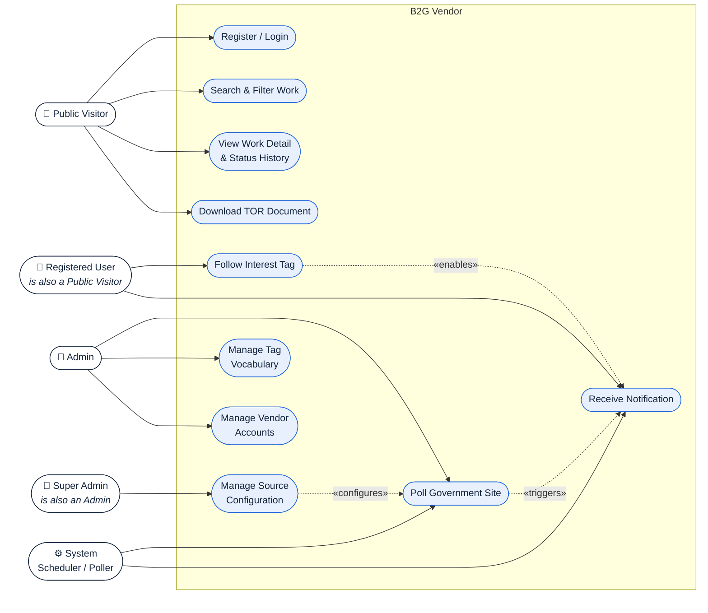

# Software Requirements Specification

for

**B2G Vendor**

Version 0.3

Prepared by Techaphatr Indhavivadhana

OTK

11/11/2026

---

## Revision History

| Version | Date | Author | Changes |
|---|---|---|---|
| 0.1 | 22/08/2026 | Techaphatr Indhavivadhana | Initial version. |
| 0.2 | 04/11/2026 | Techaphatr Indhavivadhana | Sections 4 and 5 brought in line with the implemented system: an implementation status on every FR and NFR; new FR-1.7 to FR-1.12, FR-2.11 to FR-2.13 and FR-5.5; security NFRs for the authentication, CSRF, header and document-handling work; new Section 5.6 Verification Requirements; open issues in Section 7.1 updated; the site-coverage assumption in Section 2.5 corrected. The use case model (Section 6) is unchanged. |
| 0.3 | 11/11/2026 | Buravit Yenjit | Requirements brought in line with the API test work, and the use case diagram redrawn. *Current* notes added or corrected, and a *Verification* line added, for sign-in, password reset and password change (FR-1.7, FR-1.10, Section 5.3), search and filters (FR-4.1, FR-4.2, FR-4.6), work detail, status history and status integrity (FR-2.5, FR-4.3, FR-5.1, FR-5.4, FR-5.5), following, pausing and unfollowing tags (FR-3.1, FR-3.6, FR-3.7), and source configuration and the Super Admin gate (FR-2.3, FR-2.8, FR-2.11); Section 5.6 (NFR-V1, NFR-V3, NFR-V5) records which use cases and security controls the API tests now cover. The use case diagram in Section 6.1 is redrawn in Mermaid so that GitHub displays it (its content is unchanged). The architecture and API reference are new documents in `docs/`, and `ProjectDescription.md` moved there. |

---

## Table of Contents

1. [Introduction](#1-introduction)
   1.1 [Purpose](#11-purpose)
   1.2 [Document Conventions](#12-document-conventions)
   1.3 [Intended Audience and Reading Suggestions](#13-intended-audience-and-reading-suggestions)
   1.4 [Product Scope](#14-product-scope)
   1.5 [Stakeholders](#15-stakeholders)
   1.6 [References](#16-references)
2. [Overall Description](#2-overall-description)
   2.1 [Product Perspective](#21-product-perspective)
   2.2 [Product Functions](#22-product-functions)
   2.3 [User Classes and Characteristics](#23-user-classes-and-characteristics)
   2.4 [Design and Implementation Constraints](#24-design-and-implementation-constraints)
   2.5 [Assumptions and Dependencies](#25-assumptions-and-dependencies)
3. [Specific Requirements (User Stories)](#3-specific-requirements-user-stories)
   3.1 [Account & Access Management](#31-account--access-management)
   3.2 [Government Data Ingestion & Source Management](#32-government-data-ingestion--source-management)
   3.3 [Interest Tags & Notifications](#33-interest-tags--notifications)
   3.4 [Search, Browse & Status Display](#34-search-browse--status-display)
   3.5 [TOR Document Access](#35-tor-document-access)
4. [System Features](#4-system-features)
   4.1 [Account & Access Management](#41-account--access-management)
   4.2 [Government Data Ingestion & Source Management](#42-government-data-ingestion--source-management)
   4.3 [Interest Tags & Notifications](#43-interest-tags--notifications)
   4.4 [Search, Browse & Status Display](#44-search-browse--status-display)
   4.5 [TOR Document Access](#45-tor-document-access)
5. [Non-Functional Requirements](#5-non-functional-requirements)
   5.1 [Performance Requirements](#51-performance-requirements)
   5.2 [Safety Requirements](#52-safety-requirements)
   5.3 [Security Requirements](#53-security-requirements)
   5.4 [Software Quality Attributes](#54-software-quality-attributes)
   5.5 [Business Rules](#55-business-rules)
   5.6 [Verification Requirements](#56-verification-requirements)
6. [Use Case Model](#6-use-case-model)
   6.1 [Use case diagram](#61-use-case-diagram)
   6.2 [Use case descriptions](#62-use-case-descriptions)
7. [Open Issues and Assumptions](#7-open-issues-and-assumptions)
   7.1 [Unclear Requirements](#71-unclear-requirements)
   7.2 [Justified Assumptions](#72-justified-assumptions)
8. [Appendices](#8-appendices)
   8.1 [Glossary](#81-glossary)

---

## 1. Introduction

### 1.1 Purpose

The purpose of this document is to specify the software requirements for **B2G Vendor**. This SRS describes the functional and non-functional requirements for the public-facing web application and its administrative console that together ingest, index, and disclose government procurement and Terms of Reference (**TOR**) data from multiple Thai government agencies.

The scope of this document covers the full lifecycle of the platform, including:

- Unified account registration and login (individual and business).
- Admin-controlled polling of government open-data sources.
- Subscription to interest tags and notification of matching new work.
- Cross-site search with live, source-derived status display.
- TOR document access and download.

**Out of Scope:** This SRS explicitly excludes any bidding, deal execution, or announcement-publishing functionality — the platform is strictly a read-only disclosure and notification layer. It also excludes the internal operation of any government e-GP system and the internal training or operation of the third-party AI service used for auto-tagging.

### 1.2 Document Conventions

The following conventions are used throughout this document:

- **Boldface** is used to emphasize specific user interface elements (e.g., buttons, page titles) and actor names.

- `Courier New` font is used for system states, error messages, and technical field/status values (e.g., `BIDDING`, `Poll Timeout`).

- Priorities for requirements are assumed to be **High** unless explicitly marked as **Optional** or **Low Priority**.

- The term "**User**" refers to a Registered User unless "**Visitor**" is specified.

- Every functional requirement (Section 4) and non-functional requirement (Section 5) carries its implementation status as of the revision date: *Implemented* (built and working as described), *Partial* (built in part — a *Next* note says what remains), or *Planned* (agreed but not yet built, or a target not yet measured). *Implemented, optional* marks built behavior that stays off unless it is configured.

### 1.3 Intended Audience and Reading Suggestions

This document is intended for the following stakeholders:

- **Product Owner:** Should focus on Section 2 (Overall Description) and the User Stories in Section 3 to ensure the disclosure and notification experience aligns with vendor needs.

- **Developers:** Should review Section 3 (Specific Requirements) in detail, paying close attention to the Functional Requirements and Non-Functional Requirements (such as per-site poll rate limits, Argon2/bcrypt hashing, and the Admin vs. Super Admin role split).

- **Testers:** Should use Section 3 as the primary basis for creating Test Cases and acceptance criteria, specifically noting the boundary values (e.g., the 7-site launch scope, poll interval presets, and session timeout).

It is recommended that all readers start with Section 1 and Section 2 for a high-level understanding before diving into the technical specifications in Section 3.

### 1.4 Product Scope

B2G Vendor is a standalone web platform designed to centralize government procurement disclosure. It acts as a unifying interface between vendors, businesses, and the public on one side, and the scattered procurement/TOR datasets published by multiple government agencies on the other.

The primary objective of the software is to remove the need to separately monitor each agency's own procurement page, by polling two official sources on an admin-controlled schedule and surfacing the results through unified search and notifications: the **e-GP RSS feed** (`process3.gprocurement.go.th`) for live new/updated TOR announcements, and the **`data.go.th`** open-data catalog for historical contract-level enrichment once a project is awarded. Key benefits include:

- **Accessibility:** One search across every connected government site instead of many.
- **Personalization:** Users follow interest tags (site, agency, method, category, keyword) and are notified only about relevant new work.
- **Transparency:** Status is always derived from ingested source data — never manually edited — so search results, work detail, and notifications never disagree with one another.

The system is constrained to **7 government sites at launch** (BMA, Department of Highways, PEA, EGAT, Office of the Permanent Secretary of the Ministry of Public Health, depa, and DGA), extensible only by a Super Admin, and it does not scrape or crawl HTML — ingestion is via polling the e-GP RSS feed and `data.go.th`; the single exception is that the one announcement page an RSS item itself links to (in practice, a winner announcement) is read for its price (FR-2.3a).

### 1.5 Stakeholders

A stakeholder is anyone affected by, or with a vested interest in, this project's outcome — distinct from the delivery-team roles listed in Section 1.3.

- **Product Owner / Project Sponsor:** The Visionary. Accountable for the business outcome — which government sites and features ship first — and bears the consequence if the platform fails to match real vendor workflows.

- **Registered Users (Vendors & Contractors, Businesses/SMEs):** The End-Consumers. Directly affected by the platform's accuracy and timeliness — a missed or late notification can mean a missed bidding opportunity.

- **Public Visitors:** The Researchers. Affected by how easily public procurement disclosure can be found and verified, without needing an account.

- **Admin & Super Admin (Portal Operations Staff):** The Operators. Affected daily by the usability of the ingestion, tagging, and account-management tooling they rely on to keep the platform trustworthy.

- **Government Agencies:** The Data Publishers. An indirect stakeholder — the system depends entirely on the continued availability and schema stability of their published data, and their name/brand is what appears in every search result and notification, even though they do not interact with or control this system.

### 1.6 References

- IEEE Std 830-1998, *IEEE Recommended Practice for Software Requirements Specifications.*

- `data.go.th` (Open Government Data of Thailand), *CKAN Action API Documentation.* (For historical/enrichment ingestion.)

- e-GP RSS Feed, `process3.gprocurement.go.th/EPROCRssFeedWeb/egpannouncerss.xml`. (For live TOR announcement ingestion — the primary data source.)

- Thailand Personal Data Protection Act (PDPA) B.E. 2562 (2019). (For user and notification data handling.)

- Web Content Accessibility Guidelines (WCAG) 2.1, Level AA. (For accessibility requirements.)

---

## 2. Overall Description

### 2.1 Product Perspective

B2G Vendor is a web application that functions as a unifying interface between the public/vendors and the scattered procurement-disclosure datasets published by multiple government agencies. It is not part of any government e-GP system and does not modify or publish to those systems — it is strictly read-only.

The product is standalone: it has no native data of its own, and its usefulness is entirely dependent on data that government agencies choose to publish through their official channels. Internally, ingestion is kept independent from the public-facing site, so that a problem fetching data from one government site never takes down search or browsing for everyone else. The full technical detail of how and where data is fetched is specified in Section 4.2 and Section 5, not repeated here.

### 2.2 Product Functions

B2G Vendor provides five major functional groups, each expanded into full detail as its own System Feature in Section 4:

- **Account & Access Management** *(Section 4.1)*
  - Unified registration/login for individual and business accounts.
  - Role-based access: Visitor, Registered User, Admin, Super Admin.

- **Government Data Ingestion & Source Management** *(Section 4.2)*
  - Manual ("Poll Now") and scheduled polling, per government site.
  - Per-site run history (fetched / new / updated / failed).
  - Source configuration (which sites are polled) restricted to Super Admin.

- **Interest Tags & Notifications** *(Section 4.3)*
  - Follow tags across government site, agency, method, category, and keyword.
  - Automatic, AI-assisted tagging of newly ingested work.
  - In-app and email notification when a followed tag matches new work.

- **Search, Browse & Status Display** *(Section 4.4)*
  - Full-text and faceted search across every connected site.
  - Browse by government site, drillable into department/agency.
  - Status badge sourced only from ingested data — never manually edited.

- **TOR Document Access** *(Section 4.5)*
  - Work detail page with status history.
  - TOR and attachment download.

### 2.3 User Classes and Characteristics

The system identifies four primary user classes, plus one non-human actor. The focus of this SRS is strictly on the **Registered User** and the **Admin/Super Admin** roles, as they are the primary actors for all core functions.

- **Public Visitor (Secondary)**
  - *Characteristics:* An unauthenticated browser of public disclosure data. May range from a first-time researcher to a returning vendor who has not yet registered.
  - *Privileges:* Full search, work detail, and TOR download.
  - *Restrictions:* Cannot follow interest tags or receive notifications until registering.

- **Registered User (Primary)**
  - *Characteristics:* An individual or business account holder. May vary from an occasional bidder to a vendor monitoring dozens of tags daily.
  - *Privileges:* Everything a Visitor can do, plus following unlimited interest tags, receiving notifications, and managing their own profile.
  - *Constraints:* Subject to standard session expiry and PDPA-governed handling of contact and preference data.

- **Admin**
  - *Characteristics:* Portal operations staff responsible for day-to-day data quality.
  - *Privileges:* Every Admin can use the dashboard, manage vendor accounts and review the audit log. Beyond that an Admin holds one of three roles, chosen by a Super Admin: **Poll Admin** (trigger and schedule polling, review run history), **Tag Admin** (manage the tag vocabulary and the tags on each work) or **Poll and Tag Admin** (both).
  - *Restrictions:* Cannot add, remove, or repoint which government sites are polled, and cannot manage other admin accounts. An Admin sees, and may call, only what their role covers — enforced server-side, not only hidden in the UI. An Admin created before roles were split has no role until a Super Admin assigns one.

- **Super Admin (Primary among staff)**
  - *Characteristics:* Senior or trusted operations staff, a tier above Admin.
  - *Privileges:* Everything an Admin can do under any role, plus **source configuration** — adding a new government site, enabling/disabling one, and setting its poll scope and request-rate limit — and **admin account management**: creating Admin accounts, choosing each one's role, suspending or removing them.
  - *Restrictions:* Still bound by a fixed internal concurrency-safety limit that is not exposed as a setting to anyone, including Super Admin.

- **System (Non-human)**
  - *Characteristics:* The automated poller, scheduler, change-detector, notification engine, and search indexer.
  - *Behavior:* Acts only on Admin/Super Admin-configured schedules and scope; never publishes or edits source data.

### 2.4 Design and Implementation Constraints

The design and development of B2G Vendor must adhere to the following strict constraints:

- **Regulatory & Security:**
  - Data Encryption: All transmission must use HTTPS (TLS 1.2+).
  - Password Storage: Local account passwords must be hashed using Argon2 or bcrypt.
  - Data Source Credentials: Any dataset/API access details are stored in server-side configuration, never exposed to the client.

- **Data Source:**
  - No Scraping: Ingestion is via the e-GP RSS feed (live) and the `data.go.th` open-data catalog (historical enrichment) for every connected government site. The only HTML ever read is the single announcement page an RSS item itself links to (FR-2.3a) — no crawling, no listing or search pages, no links followed — and reading it can be disabled by configuration.
  - Correct Encoding: The e-GP RSS feed is Windows-874 (Thai codepage) encoded, not UTF-8, despite looking like standard XML; it must be decoded explicitly as Windows-874.
  - Adapter Isolation: Each government site's response mapping lives in its own adapter, per source, since dataset schemas differ by organization and the two sources are structurally different (XML/RSS vs. JSON/CKAN).

- **Hardware & Performance:**
  - Search Latency: Faceted search results must return within 1.5 seconds at p95 for typical queries.
  - Poll Etiquette: Each site's poll respects that site's own configured request-rate limit.
  - Page Load: Core public pages interactive within 2.5 seconds on mid-range mobile / 4G.

- **Business Rules:**
  - Launch Scope: 7 government sites at launch, extensible later.
  - Source Config Gate: Adding/enabling/disabling a government site is restricted to Super Admin.
  - Status Integrity: Status values are never manually editable; they come only from ingested source data.

### 2.5 Assumptions and Dependencies

The requirements in this SRS rely on the following assumptions:

1. **Live Data Source Availability:** The system depends on the continued availability of the e-GP RSS feed, since it is the primary and only source that can discover a new or updated TOR. An outage there stops "new work" detection entirely for the affected site until the feed recovers.

2. **Historical Data Source Availability:** The system depends on the continued availability and schema stability of `data.go.th`'s per-agency contract datasets for enrichment only. An outage or breaking schema change there degrades budget/winner enrichment for that site, but does not stop new TOR from being discovered via the RSS feed.

3. **AI Service Availability:** Automatic tagging is a best-effort dependency on a third-party AI service (planned: Vertex AI). Its unavailability degrades tagging quality but does not block ingestion.

4. **Browser Capability:** Users access the application via modern web browsers that support standard TLS and responsive layouts.

5. **Site Coverage:** Each of the 7 launch government sites is assumed to have a resolvable e-GP department code (`deptId`) for the live feed, and, where available, a resolvable `data.go.th` organization for enrichment. The `data.go.th` organizations were confirmed for all 7 during requirements analysis, but the `deptId` part holds only partly: codes are verified live for the Office of the Permanent Secretary of MOPH, the Department of Highways and depa; PEA and EGAT publish per branch and have no single agency-wide code; DGA's code must be read from a real DGA purchase order; and BMA's code is not yet configured (see Section 5.5, Launch Scope, and Section 7.1).

---

## 3. Specific Requirements (User Stories)

### 3.1 Account & Access Management

**US-1.1:** As a Visitor, I want to register once with either an individual or business profile, so that I don't need to pick between separate account types.

**US-1.2:** As a Visitor, I want to log in with a single unified form, so that I don't need to remember which account type I used.

**US-1.3:** As a User, I want access to following tags and notifications restricted until I log in, so that my interests are saved securely to my personal profile.

**US-1.4:** As a User, I want to reset my password by email, so that I can regain access without contacting support.

**US-1.5:** As an Admin, I want to search, add, and suspend or delete vendor accounts, so that I can manage the account base on an ongoing basis.

### 3.2 Government Data Ingestion & Source Management

**US-2.1:** As an Admin, I want to trigger a manual poll for one government site or all enabled sites, so that I can refresh data immediately when needed.

**US-2.2:** As an Admin, I want to set a recurring poll interval (default every 24 hours; never more often than every 2 hours), so that data stays current without manual work.

**US-2.3:** As an Admin, I want to see each poll run's results broken down by government site, so that I can trust the data and catch failures at any one source.

**US-2.4:** As a Super Admin, I want to add a new government site to the poll list, so that coverage can grow without a code change or redeploy.

**US-2.5:** As a Super Admin, I want to enable or disable a specific government site, so that I can pause a source that is misbehaving without affecting the others.

**US-2.6:** As an Admin, I want a failed poll to retry and alert me, so that an outage at one government site doesn't silently break the rest of the portal.

### 3.3 Interest Tags & Notifications

**US-3.1:** As a User, I want to follow multiple interest tags across government site, agency, method, category, and keyword, so that I hear about all the kinds of work I care about.

**US-3.2:** As a User, I want to be notified when newly ingested work carries a tag I follow, so that I don't have to check manually.

**US-3.3:** As a User, I want to choose notification channel and frequency (in-app, email; instant or daily digest), so that I control volume.

**US-3.4:** As a User, I want to add or remove followed tags at any time, so that I can tune what I'm subscribed to as my interests change.

**US-3.5:** As an Admin, I want to create and retire tags, so that the vocabulary stays clean without duplicate or near-duplicate entries.

### 3.4 Search, Browse & Status Display

**US-4.1:** As a Visitor, I want fast, typo-tolerant search across titles, metadata, and TOR content, so that I can find work even by terms inside the TOR.

**US-4.2:** As a Visitor, I want to filter results by status, government site, agency, method, budget, and date, so that I can narrow results precisely.

**US-4.3:** As a Visitor, I want to see each work's status directly in the results list, so that I can tell open vs. closed/cancelled without opening each one.

**US-4.4:** As a Visitor, I want to browse by government site and then by department, so that I can follow a specific organization's activity.

**US-4.5:** As a Visitor, I want clear loading, empty, and error states, so that the site never looks blank or broken.

### 3.5 TOR Document Access

**US-5.1:** As a Visitor, I want to open a work's detail page to see its full metadata and status history, so that I can evaluate whether it's relevant to me.

**US-5.2:** As a Visitor, I want to download the TOR and any attachments directly, so that I have the official documents.

---

## 4. System Features

This section organizes the specific functional requirements into logical features. Each feature includes a description, the specific system behaviors (`The system shall...`), and a traceability mapping to the corresponding User Story (US).

Every requirement carries its implementation status as of 04/11/2026 (see Section 1.2). *Current* notes describe how the shipped system actually behaves where it adds detail to the requirement; *Next* notes describe the agreed follow-up work for anything not yet complete. How each feature is verified is summarized at the end of each feature and planned in Section 5.6.

### 4.1 Account & Access Management

**Description:** This feature manages user identity, ensuring one unified login for both individual and business accounts. It handles registration with email verification, session persistence, password hashing and recovery, staff roles, and account administration.

- **Functional Requirements:**
  - **FR-1.1** *(Implemented)*: The system shall provide a single `Account` entity where individual/business is an attribute, not a separate login flow.
  - **FR-1.2** *(Implemented)*: The system shall capture business fields (tax ID, company name) in an optional business profile on the same account. The tax ID shall be exactly 13 digits, and the company name is required whenever the business profile is included.
  - **FR-1.3** *(Implemented)*: The system shall authenticate all users — vendors and staff alike — through one unified login form regardless of account type, and after sign-in shall return the user to the page they came from (same-site paths only) or to the account dashboard.
  - **FR-1.4** *(Implemented)*: The system shall restrict tag-following, notification settings, the notification center and the user's profile to authenticated users only, enforced server-side.
  - **FR-1.5** *(Implemented)*: The system shall allow Admins to search (by name, email, or status), add, suspend/reactivate, and delete vendor accounts directly from an account list. Suspending an account shall end all of its sessions. A vendor account created by an Admin shall receive a one-time password-setup link by email.
  - **FR-1.6** *(Implemented)*: The system shall log every account status change (suspend, reactivate, delete) with actor and timestamp.
    - *Current:* The audit log covers more than account status: every create, update and delete of accounts, tags, works, government sites and ingestion settings is recorded with a field-level before/after diff, the actor, the request path and a timestamp. Secrets are masked (`[REDACTED]`). Entries are append-only — the data layer refuses any edit or delete — and are searchable and filterable on the **Audit Log** page.
  - **FR-1.7** *(Implemented)*: The system shall let a user reset a forgotten password by email with a single-use link valid for 1 hour. The request shall get the same answer whether or not the email is registered, and a completed reset shall end every session of the account and clear any sign-in lockout.
    - *Current:* Forgot-password and reset-password share a limit of 5 requests per hour per IP address.
  - **FR-1.8** *(Implemented)*: The system shall require a self-registered account to verify its email address before it can sign in. Registration sends a single-use verification link valid for 24 hours and does not start a session. If email delivery is not configured or the email cannot be sent, registration shall be refused (`SERVICE_UNAVAILABLE`) and shall leave no account behind. Accounts created by staff or by seed scripts are treated as already verified.
  - **FR-1.9** *(Implemented)*: The system shall apply one password policy on registration, password change and password reset: at least 8 characters, at least one letter and one number, at most 72 bytes in UTF-8 (the bcrypt input limit), and not present in the Have I Been Pwned breached-password list. The breach check shall send only the first 5 characters of the password's SHA-1 hash (k-anonymity range query); if the check service is unavailable, the request shall be refused rather than the check skipped.
  - **FR-1.10** *(Implemented)*: The system shall let a signed-in user change their password after re-entering the current one. All of the user's other sessions shall be ended; the session that made the change stays signed in. A wrong current password counts toward the same account lock as a failed sign-in, so a stolen session cannot be used to guess the password.
  - **FR-1.11** *(Implemented)*: The system shall split staff into roles. Every Admin can use the dashboard, manage vendor accounts and read the audit log, and additionally holds one role chosen by a Super Admin: **Poll Admin** (polling and run history), **Tag Admin** (tag vocabulary and the tags on each work) or **Poll and Tag Admin** (both). Only a Super Admin shall create Admin accounts, set their role, suspend/reactivate them, sign them out of every session, send them a password link, or delete them. Roles shall be enforced server-side; an Admin created before the role split has no role until a Super Admin assigns one.
  - **FR-1.12** *(Implemented)*: The system shall let a signed-in user view and edit their own profile (name, phone, business profile) and notification settings.

- **Traceability:**
  - US-1.1 (Register) → FR-1.1, FR-1.2, FR-1.8, FR-1.9
  - US-1.2 (Unified Login) → FR-1.3
  - US-1.3 (Restrict Access) → FR-1.4, FR-1.12
  - US-1.4 (Reset Password) → FR-1.7, FR-1.9, FR-1.10
  - US-1.5 (Manage Accounts) → FR-1.5, FR-1.6, FR-1.11

- **Verification:** Covered today by the automated checks `check:auth`, `check:auth-enumeration`, `check:login-lockout`, `check:pwned-passwords`, `check:admin-accounts`, `check:admin-staff`, `check:admin-permissions` and the `check:audit-*` suites. Planned additions are listed in Section 5.6.

### 4.2 Government Data Ingestion & Source Management

**Description:** The core feature that pulls procurement and TOR data from every connected government site via **two sources** — the e-GP RSS feed (live, primary) and `data.go.th` (historical, enrichment-only) — normalizes it into one schema, and makes it available to search and notifications. Source configuration is gated behind Super Admin. Polling runs in a separate ingestion worker, so the public site keeps working while a poll runs or fails.

- **Functional Requirements:**
  - **FR-2.1** *(Implemented)*: The system shall allow an Admin to immediately run an ingestion job against one site or all enabled sites and report results.
    - *Current:* **Poll Now** queues a poll job, which the ingestion worker picks up within seconds (it checks the queue every 5 seconds); the results appear in run history.
  - **FR-2.2** *(Implemented)*: The system shall allow an Admin to configure a recurring poll interval, in hours — default 24 hours, minimum 2 hours, maximum 30 days (all enforced server-side) — which the scheduler applies to every enabled site (with an optional per-site override obeying the same limits), runs automatically, and can pause/resume. A disabled site is skipped by every scheduled poll and by "Poll Now → all sites".
    - *Current:* The interval and the pause switch are stored in the database, so a change takes effect without a restart; the scheduler checks for due sites every minute.
  - **FR-2.3** *(Implemented)*: The system shall, for each configured site's e-GP department code (`deptId`), poll the e-GP RSS feed across its enabled announcement types (procurement plan, reference price, draft TOR, invitation, cancellation, amendment, winner, and the cancellation or amendment of a winner result) and extract each item's title, project identifier, announcement-type label, publish date, and link. **This is the primary and only source capable of discovering a new or updated TOR.**
    - *Current:* Announcement-type codes are `P0`, `15`, `B0`, `D0`, `D1`, `D2`, `W0`, `W1` and `W2`. A newly added site polls `B0` and `D0` unless the Super Admin selects others (at least one, each once). The feed is decoded as Windows-874.
  - **FR-2.3a** *(Implemented)*: The system shall classify each RSS item's link as either a direct document (e.g. PDF) or an HTML detail-page reference before storage; a direct document shall be downloaded and stored, an HTML reference shall be recorded as a URL to the source page and additionally read: the system shall request only the exact URL the feed provides for that item, only on e-GP hosts and at a throttled rate, extract its text, and use it to determine the price (for a winner announcement, the winning bid, presented as such rather than as a budget). The page itself is not stored and nothing on it is followed. This reading can be disabled by configuration.
    - *Current:* Each page read is capped at 2 MB and 30 seconds, paced by the site's request-rate limit, attempted at most 3 times at least 6 hours apart, and limited to 40 pages per site per poll. Redirects are checked against the same e-GP host rule. The off switch is `EGP_HTML_TOR_ENABLED=false`.
  - **FR-2.4** *(Implemented)*: The system shall upsert ingested records by a stable key (the project identifier) scoped per site, so re-polling updates rather than duplicates, and so records from either source correlate to the same work.
  - **FR-2.5** *(Implemented)*: The system shall flag brand-new works and changed fields (especially status) and emit events consumed by the notification and search features.
    - *Current:* Every announcement is recorded once in the work's status history, in order of publication, and tags newly added to a work trigger the notification matching of FR-3.3. A work's status is that of its latest announcement by publish date, never of the one read last: an older announcement that a feed still lists (or that turns up late, or after another type's feed has stopped listing the work) is filed in its place in time and cannot change the status, and re-reading a feed adds nothing. A newer announcement of the same type (a second amendment, a new invitation after a cancellation) is a new event. `npm run backfill:status-history` (`-- --dry-run` to only report) repairs works written by the older poll.
  - **FR-2.6** *(Implemented)*: The system shall record, per government site and per source, a run's start/end time, counts (fetched / new / updated / skipped / failed), and errors, viewable and filterable in the admin panel.
  - **FR-2.7** *(Partial)*: The system shall retry a failed poll with backoff and alert the Admin; a failure at one government site or one source shall not corrupt already-ingested data or block polling of the others.
    - *Current:* Requests to the e-GP RSS feed and `data.go.th` are retried twice with exponential backoff (0.5 s, then 1 s), and a failure is isolated to its site and source. Failed runs are visible in run history and counted (last 24 hours) on the admin dashboard.
    - *Next:* Actively alert Admins about a failed run (in-app and/or email) instead of relying on them to open the dashboard.
  - **FR-2.8** *(Implemented)*: The system shall restrict adding, removing, enabling, disabling, or repointing a government site to Super Admin only; Admins may view but not edit the site list.
    - *Current:* Adding a site, editing any of its settings (name, short code, `deptId`, announcement types, request rate, own poll interval, the `data.go.th` settings), enabling or disabling it, the live `deptId` check and the `deptId` suggestions are Super Admin only. The server answers 401 to a visitor and 403 to a vendor or any kind of Admin, decides it from the account stored in the database on every request (so a demoted, suspended or deleted account is refused on its next request), and does so before it looks at the request body. Every Admin can still view the list. There is no delete: disabling is how a source is taken out of use.
    - *Current:* Invalid input is refused before anything is saved (400, with a message for each field at fault; nothing is changed, not even a valid field sent beside a bad one). The `deptId` must be digits only (1 to 10, such as `2102` or `4520101`); the short code at most 20 letters, digits, dot, dash or underscore; the name and English name at most 200 characters without control characters or line breaks; at least one announcement type, each listed once; a request rate of 1 to 600 per minute; an own poll interval of 2 hours to 30 days; the `data.go.th` identifiers letters, digits, dot, dash or underscore. An edit must change at least one field, and `null` clears the own poll interval or a `data.go.th` setting. A `deptId`, short code or name that another site already uses is refused with 409 naming the field and the site that has it (a site's tag is named after it, so two sites cannot share a name). A malformed site id is 400.
    - *Current:* A change applies from the next poll with no restart: the poll reads the site's current `deptId`, announcement types and request rate when it starts, a disabled site is skipped by the scheduler and by "Poll Now → all sites" and cannot be polled by hand, and a poll queued just before a site was switched off fetches nothing. Renaming a site renames its tag (the tag keeps its id, so its followers stay) and updates the short-code alias.
  - **FR-2.9** *(Implemented)*: The system shall prevent a manual poll and a scheduled poll for the same site and source from running destructively at the same time. While any poll is queued or running, "Poll Now" shall be locked for every admin account, including after a page refresh, and a poll abandoned by a crashed worker shall not hold that lock indefinitely.
    - *Current:* The lock is derived on the server from the poll-job queue; a new request is refused (`409`) while a poll is active. A running job sends a heartbeat every 15 seconds; a job silent for 2 minutes is treated as abandoned and closed by the worker.
  - **FR-2.10** *(Implemented)*: The system shall periodically fetch each configured site's `data.go.th` contract-level dataset, where one exists, and attach budget, contract number/dates, and winner information to the matching already-ingested work by its project identifier. This source shall never create a new work on its own.
  - **FR-2.11** *(Implemented)*: The system shall help a Super Admin find a site's `deptId` while adding it: typing an agency name or code shall suggest candidate codes — derived from the Ministry of Finance department list on `data.go.th`, plus agencies the team has verified live — each labelled as *confirmed* or *derived*, and flagged if a site already uses it. A **Verify live** action shall probe the real e-GP feed for the code before it is saved. If the department list cannot be loaded, only the verified agencies are offered.
    - *Current:* **Verify live** is read-only (nothing is saved), checks up to three announcement types (draft TOR and invitation by default) in parallel, shows up to three real titles per type, reports a type that fails or does not answer within 15 seconds against that type only, and refuses a `deptId` that is not digits without contacting the feed. A suggestion whose code a site already uses is flagged with that site, also while the department list is unavailable.
  - **FR-2.12** *(Implemented)*: The system shall read a work's procurement facts deterministically (without AI) during ingestion: the procurement method (stored as a `method` tag), the fiscal year in the Buddhist Era (taken from the documents or title when stated, otherwise estimated from the e-GP project number and marked as an estimate), and the bid-submission deadline (read only from invitation and amendment documents, never guessed). It shall also read the price: the reference price (ราคากลาง) from the TOR, or for a winner announcement the winning bid, recorded as such and never overwriting a reference price. When no price can be found, the system shall record why (not stated, unreadable document, or no document).
  - **FR-2.13** *(Implemented, optional)*: The system shall support restricting the public site to one or more topics chosen by an Admin (for example, software projects). When this filter is switched on, every work is still ingested and stored, but works whose tags include none of the topic tags an Admin has flagged are hidden from public listings; Admins can review hidden works and correct their tags.

- **Traceability:**
  - US-2.1 (Manual Poll) → FR-2.1
  - US-2.2 (Scheduled Poll) → FR-2.2
  - US-2.3 (Run History) → FR-2.6
  - US-2.4 (Add Site) → FR-2.8, FR-2.11
  - US-2.5 (Enable/Disable Site) → FR-2.8
  - US-2.6 (Retry & Alert) → FR-2.7, FR-2.9
  - US-4.2 (Filters) and US-5.1 (View Detail) → FR-2.12 (the facts these filters and the detail page rely on)
  - FR-2.3, FR-2.3a, FR-2.4, FR-2.5, FR-2.10 → the *Poll Government Site* use case (Section 6.2)
  - FR-2.13 → customer scope requirement (see Section 5.5, Topic Scope Rule)

- **Verification:** Covered today by `check:source-config` (the Super Admin gate on every source-configuration write; adding, editing, enabling and disabling a site; what is refused before saving; Verify live and the suggestions over HTTP; and that each change reaches the next poll, run against a mock e-GP feed), `check:poll-control`, `check:admin-ingestion`, `check:html-tor`, `check:price`, `check:facts`, `check:facts-db`, `check:facts-ingestion`, `check:tor-files` and `check:deptid-suggest`, all against local mock e-GP and `data.go.th` servers. `check:ingestion` currently points at a missing test file and must be repaired (Section 5.6).

### 4.3 Interest Tags & Notifications

**Description:** Manages the controlled tag vocabulary, AI-assisted automatic tagging of ingested work, and the matching/notification pipeline that alerts users when a followed tag appears on new work.

- **Functional Requirements:**
  - **FR-3.1** *(Implemented)*: The system shall let a user follow tags from a controlled taxonomy grouped by facet (site, agency, method, category, keyword), addable/removable at any time.
    - *Current:* There is no limit on how many tags a user follows. Following a tag the user already follows changes nothing (the website's button turns that case into an unfollow, as in Use Case 6.2.5), and unfollowing a tag that is not followed is equally harmless, so a double click, a retry or two open tabs never leave a duplicate or an error. A retired tag cannot be followed (404); a follow that was already in place when the tag was retired is kept (dormant, and live again if the tag is reactivated), is listed as retired, and can still be paused or removed. An id that is no tag is 404 and a malformed id is 400, on every follow endpoint. A user sees and changes only their own follows. The website forgets the follows and notifications it was showing as soon as the user signs out, their session ends or another account signs in.
  - **FR-3.2** *(Partial)*: The system shall automatically assign each ingested work 1..N tags, derived from its government site and agency/method (structured fields) plus AI-based classification of its Thai-language title and TOR text for category/keyword tags, optionally admin-curated afterward.
    - *Current:* The government-site tag is assigned automatically and the method tag deterministically (FR-2.12). Category and keyword tags are chosen by an AI model (OpenRouter by default, Vertex AI as an alternative) from the controlled vocabulary; the model may also propose at most one new tag per work, which is created for later admin review. Admins can add or remove any tag on a work, and a tag an Admin removed stays removed on later polls.
    - *Next:* Assign agency tags automatically (today an Admin must create and apply them by hand), and define the AI confidence threshold (Section 7.1).
  - **FR-3.3** *(Implemented)*: The system shall, on every "new work" event, compute the intersection of the work's tags and each user's followed tags and queue a notification for every matched user. Paused follows shall not match.
  - **FR-3.4** *(Implemented)*: The system shall allow an Admin to create and retire tags and reassign a work's tags; duplicate/near-duplicate tags are prevented at creation and resolved by retiring the redundant one, not by merging.
    - *Current:* Each tag can carry aliases (synonyms). The server refuses a tag whose name or alias matches an existing one (`DUPLICATE_TAG`, pointing to the retired tag to reactivate where there is one) and refuses a near-duplicate unless the Admin confirms it (`NEAR_DUPLICATE_TAG`). A retired tag can be reactivated.
  - **FR-3.5** *(Implemented)*: The system shall deliver notifications via an in-app notification center (required) and email (optional), with instant or daily-digest frequency.
    - *Current:* The notification center shows read/unread state, with mark-as-read and mark-all-read. Email is sent only to addresses that have been verified (FR-1.8) and only while the user has email notifications switched on. The daily digest is sent at 08:00.
    - *Next:* Pin the digest schedule to Asia/Bangkok time; it currently follows the server's time zone, and the containers set none.
  - **FR-3.6** *(Implemented)*: The system shall send at most one notification per work per user, even if multiple followed tags match or the work is re-polled.
    - *Current:* This covers the email as well as the in-app entry: when a later poll adds another followed tag to a work the user was already told about, the in-app entry is refreshed but no second email is sent.
  - **FR-3.7** *(Partial)*: The system shall allow a user to pause, edit, or delete a followed tag, and support email unsubscribe without requiring login.
    - *Current:* Pausing, resuming and removing a followed tag work. Pausing silences that follow only (no in-app entry and no email) while the tag stays followed; resuming brings it back for the next new work, not for work missed meanwhile. Pausing needs an existing follow (404 otherwise, so it cannot be used to follow), takes exactly `{"paused": true|false}` and is otherwise 400, and un-following a paused tag and following it again starts a fresh, un-paused follow. Follow endpoints answer 401 to a visitor and 403 to a suspended account. The **Unsubscribe** page exists but is a front-end placeholder only: it calls no backend, and notification emails carry no unsubscribe link.
    - *Next:* Add a signed, per-user unsubscribe token to every notification email and a no-login endpoint that switches email notifications off.

- **Traceability:**
  - US-3.1 (Follow Tags) → FR-3.1
  - US-3.2 (Get Notified) → FR-3.2, FR-3.3, FR-3.6
  - US-3.3 (Channel/Frequency) → FR-3.5
  - US-3.4 (Edit Tags) → FR-3.7
  - US-3.5 (Admin Tag Management) → FR-3.4

- **Verification:** Covered today by `check:follow-tags` (follow, unfollow, pause and resume; who may call it and whose follows a caller can see; what a follow, a paused follow and an unfollow do to the notifications and emails a poll produces), `check:admin-tags`, `check:admin-works` and `check:search-tags`; notification matching is also exercised inside `check:facts-ingestion`. The notification-center endpoints, the daily digest and the unsubscribe flow have no dedicated automated checks yet (Section 5.6).

### 4.4 Search, Browse & Status Display

**Description:** Provides fast, typo-tolerant, faceted search across every connected government site, and shows each work's status consistently in results and detail — always sourced from ingestion, never edited by hand.

- **Functional Requirements:**
  - **FR-4.1** *(Partial)*: The system shall provide full-text search across title, agency, metadata, and extracted TOR document text.
    - *Current:* A search is one or more words separated by spaces (at most 8 words and 200 characters), and every word must match the work's title, its description (a summary written from the TOR during ingestion) or its agency: the government site's name, English name or short code, or the name of an agency tag.
    - *Next:* Index the full extracted TOR text.
  - **FR-4.2** *(Partial)*: The system shall provide faceted filters for status, government site, agency, method, budget range, and date range, reusing the same tag taxonomy as the Interest Tags feature.
    - *Current:* Filters exist for status, government site, tags (agency, method, category and keyword — tags in the same facet are combined with OR, different facets with AND), minimum and maximum budget, publish-date range (whole Bangkok days, `YYYY-MM-DD`) and fiscal year. Results can be sorted by date, budget or submission deadline, and are paged at up to 50 per page; works that tie on the sort value keep a fixed order, so no work is repeated or skipped between pages. A malformed or unknown parameter is refused with `400`. The chosen filters are remembered in the browser and carried by every search link.
    - *Next:* Offer the minimum budget and the publish-date range on the search page (the API already accepts them).
  - **FR-4.3** *(Implemented)*: The system shall display a color-coded, text-labeled status badge on every result row and on the work detail page, reflecting the latest status derived from the e-GP RSS announcement type, with no manual override path. `data.go.th` enrichment records carry no status field and never affect this badge.
    - *Current:* Status values are `PLANNED` (`P0`, `15`), `DRAFT_TOR` (`B0`), `BIDDING` (`D0`), `CANCELLED` (`D1`, `W1`), `AMENDED` (`D2`, `W2`) and `AWARDED` (`W0`), each labelled in Thai and English. The database refuses any other status or announcement type, and the only route that writes to a work is the tag editor (`PUT /admin/works/:id/tags`), which refuses a status.
  - **FR-4.4** *(Partial)*: The system shall provide a government site directory, drillable into department/agency, linking to each site's ingested works.
    - *Current:* The directory lists every government site and its works; drilling into an agency lists the works carrying that agency tag, so it only shows agencies an Admin has tagged (FR-3.2).
  - **FR-4.5** *(Implemented)*: The system shall show a consistent loading skeleton, empty state, and retryable error state whenever results cannot be shown immediately.
  - **FR-4.6** *(Implemented)*: The system shall use Thai-aware tokenization and typo tolerance so that search works despite Thai having no word spacing.
    - *Current:* Searchable text is stored in a normalized Thai form, matched with a typo-tolerant pattern; existing works are prepared once with `npm run backfill:search-text`. A very long query (more than about 40 Thai characters) is matched exactly, without typo tolerance, so that it can never exceed the database's pattern size limit.

- **Traceability:**
  - US-4.1 (Search) → FR-4.1, FR-4.6
  - US-4.2 (Filters) → FR-4.2
  - US-4.3 (Status in Results) → FR-4.3
  - US-4.4 (Browse by Site) → FR-4.4
  - US-4.5 (Loading/Empty/Error) → FR-4.5

- **Verification:** Covered today by `check:search-filter` (keyword search, every filter alone and combined, sorting, paging limits, invalid parameters and injection attempts), `check:thai-search`, `check:search-tags` and `check:facts-db`.

### 4.5 TOR Document Access

**Description:** Provides access to a work's full detail, status history, and the ability to download its official TOR documents and attachments.

- **Functional Requirements:**
  - **FR-5.1** *(Implemented)*: The system shall provide a detail page showing title, agency, method, budget, dates, current status, and linked TOR/attachments, all sourced from ingested data.
    - *Current:* The page also shows the fiscal year (marked when estimated), the submission deadline with days remaining, whether a price is a reference price or a winning bid, and a link that opens the e-GP announcement search for the work's project number. A malformed work id is refused with `400`; an id that is unknown, or belongs to a work hidden from the public site, answers `404` "This work is no longer available."
  - **FR-5.2** *(Partial)*: The system shall provide working, HTTPS download links to every ingested TOR file and attachment.
    - *Current:* Every stored TOR file downloads as a PDF attachment from the API; HTTPS depends on the production deployment (the local stack runs over plain HTTP).
    - *Next:* Serve the production deployment over HTTPS only (see Section 5.3).
  - **FR-5.3** *(Implemented)*: The system shall deduplicate downloaded files by hash so an unchanged document is not re-downloaded on every poll.
  - **FR-5.4** *(Implemented)*: The system shall display a chronological status-change history on the detail page, matching the same status source of truth used in search.
    - *Current:* The history lists every announcement oldest first, and its last entry is always the work's current status.
  - **FR-5.5** *(Implemented)*: The system shall store and serve only genuine PDF documents: a file must begin with the `%PDF-` signature, is saved under its content hash with a safe display name, and is served as `application/pdf` with `nosniff` and as a download. ZIP bundles shall be opened within fixed limits (at most 200 entries, 50 PDFs, 50 MB per entry and 200 MB in total) and a single download is capped at 100 MB and 120 seconds. Older stored files that are not PDFs shall not be served.

- **Traceability:**
  - US-5.1 (View Detail) → FR-5.1, FR-5.4
  - US-5.2 (Download TOR) → FR-5.2, FR-5.3, FR-5.5

- **Verification:** Covered today by `check:work-detail` (the detail response, status derivation, status ordering through real polls, enrichment never changing a status, and no way to write one), `check:tor-files` and `check:html-tor`. Download behavior over HTTP (headers, missing and out-of-range files) is planned (Section 5.6).

---

## 5. Non-Functional Requirements

Each requirement below carries its status as of 04/11/2026 (Section 1.2). Targets that have not been measured yet are marked *Planned* even where the design is intended to meet them; measuring them is part of Section 5.6.

### 5.1 Performance Requirements

This section defines the specific timing and throughput constraints the system must meet to ensure a smooth user experience.

- **Page Load Speed** *(Planned — not yet measured)*: The web application shall render core public pages interactive within 2.5 seconds on mid-range mobile / 4G.

- **Search Latency** *(Planned — not yet measured)*: Faceted search results (with status and facets) shall return within 1.5 seconds at p95 for typical queries.
  - *Next:* Measure under load (Section 5.6). The keyword match is pattern-based, not index-based, so it is the first candidate for optimisation if the target is missed as the data grows.

- **Notification Timeliness** *(Implemented by design — not yet measured)*: Instant notifications shall be dispatched within approximately 5 minutes of the poll that discovered the matching work.
  - *Current:* Instant notifications are created, and their emails sent, during the poll that ingests the work.

- **Ingestion Throughput** *(Implemented)*: The system shall support incremental polling (only new/changed items since the last run where possible) to keep each run fast and light.
  - *Current:* Unchanged items are counted as skipped and not rewritten; reading of HTML announcement pages is capped per poll (FR-2.3a).

- **Poll Timeout** *(Partial)*: If a poll for a given site exceeds a configured duration, the system shall time out that run, log it as failed, and alert the Admin (`Poll Timeout`) rather than hang indefinitely.
  - *Current:* Individual downloads are time-limited (TOR files 120 s, HTML pages 30 s), and a poll abandoned by a crashed worker is closed after 2 minutes without a heartbeat (FR-2.9).
  - *Next:* Add a time limit to the RSS feed request itself and a configured maximum duration for a whole run, after which the run is logged as failed and the Admin alerted (FR-2.7).

### 5.2 Safety Requirements

This section outlines safeguards to prevent data loss or system failure scenarios that could negatively impact users.

- **Ingestion Transactionality** *(Implemented)*: Ingestion shall be transactional per item; a crashed run shall resume cleanly without half-written records.
  - *Current:* Each item is written in its own upsert keyed by project identifier; a crashed run is closed by the worker and the next poll reprocesses the same items without creating duplicates.

- **Failure Isolation** *(Implemented)*: A poll failure isolated to one government site shall not corrupt already-ingested data or block polling of the others.

- **Retry on Transient Failure** *(Implemented)*: If a poll fails due to a transient error, the system shall retry with backoff before reporting a final failure to the Admin (two retries, exponential backoff; see FR-2.7).

- **Notification Deduplication** *(Implemented)*: Re-processing an ingestion event shall never result in a duplicate notification to the same user for the same work (enforced by a unique account–work constraint in the database).

### 5.3 Security Requirements

This section defines the measures required to protect user data, identity, and system integrity.

- **Data Encryption in Transit** *(Partial)*: All data transmitted between client and server shall be encrypted using HTTPS (TLS 1.2 or higher).
  - *Current:* In production mode the API sends `Strict-Transport-Security` and session cookies are marked `Secure`; the local development stack runs over plain HTTP.
  - *Next:* Terminate TLS in the production deployment and redirect all HTTP traffic to HTTPS.

- **Password Storage** *(Implemented)*: For local accounts, the system shall never store passwords in plain text; all passwords must be hashed using Argon2 or bcrypt before storage (bcrypt, cost factor 12 by default).

- **Authentication Hardening** *(Implemented)*: The system shall resist guessing and account discovery on sign-in and sign-up:
  - After 4 failed sign-ins in a row an account is locked, first for 1 minute and then for twice as long after each further failure, up to 30 minutes (`ACCOUNT_LOCKED`); a successful sign-in or a password reset clears the count.
  - An unknown email, a wrong password and a wrong password on a suspended account get an identical answer and take a similar time (a dummy bcrypt comparison is run for unknown emails). That an account is suspended or unverified is revealed only after the correct password.
  - A sign-up with a taken email is refused with a generic `REGISTRATION_FAILED` message that does not say the email is the reason.
  - Password policy, breach check and email verification per FR-1.8 and FR-1.9.

- **Session Management** *(Partial)*: Sessions shall be server-side and revocable.
  - *Current:* Session tokens are random, stored only as hashes, and sent in an `HttpOnly` cookie (`SameSite=Lax` by default, `Secure` in production) that lasts 7 days by default. Sessions are ended on logout, password change (other sessions), password reset (all sessions), suspension, and Super Admin "sign out" of an Admin.
  - *Next:* Add an idle timeout so an unused session expires before its 7-day lifetime.

- **Role-Based Access Control** *(Implemented)*: The admin panel shall enforce strong authentication and role checks, with an explicit Admin vs. **Super Admin** split for higher-risk settings such as source configuration, and the Admin roles of FR-1.11.

- **Source Config Protection** *(Implemented)*: Adding, removing, enabling, or disabling a government site shall be accessible to Super Admin only; the restriction shall be enforced server-side, not only hidden in the UI.

- **Cross-Site Request Forgery Protection** *(Implemented)*: Every request that changes data shall come from an allowed frontend origin (checked with `Origin` / `Sec-Fetch-Site`) and be sent as `application/json`. Anything else is refused (`403 CSRF_BLOCKED` or `415 UNSUPPORTED_MEDIA_TYPE`) before it is parsed.

- **Security Headers** *(Implemented)*: The API shall send `X-Content-Type-Options: nosniff`, `X-Frame-Options: DENY`, `Content-Security-Policy: frame-ancestors 'none'` and `Referrer-Policy: no-referrer` on every response, with no `X-Powered-By` header. The web application shall send a Content Security Policy, `Referrer-Policy`, `Permissions-Policy` and `X-Frame-Options`.

- **Injection & Rate Limiting** *(Partial)*: The system shall apply OWASP Top 10 protections (especially injection on search) and rate limiting on authentication, search, and admin poll endpoints.
  - *Current:* All input is validated against strict schemas that reject unknown fields; MongoDB operator and dotted keys are stripped from input; search text is escaped before it is used in a query; email templates escape every inserted value. Sign-in is limited to 10 attempts per 15 minutes, and sign-up and forgot/reset password to 5 per hour, per IP address. A request body that is not valid JSON, or is too large, is refused with `400` or `413` rather than a server error, and a search cannot be made to fail or stall by its text (long Thai text, regular-expression characters, operators).
  - *Next:* Rate-limit search and the admin poll endpoints.

- **Outbound Request Safety** *(Partial)*: The system shall only fetch from the government sources it is configured for.
  - *Current:* HTML announcement pages are fetched only from e-GP hosts, with every redirect checked (FR-2.3a).
  - *Next:* Apply the same host allowlist to TOR file downloads, which currently follow any link the feed provides.

- **Document Handling** *(Implemented)*: Downloaded and served documents shall be limited and validated per FR-5.5.

- **Infrastructure Hardening** *(Planned)*: The production deployment shall require authentication on MongoDB and not expose its port publicly, run application containers as a non-root user, and scan dependencies for known vulnerabilities on every change (Section 5.6).

- **Privacy** *(Partial)*: Contact information, notification preferences, and followed tags shall be stored and processed in a PDPA-compliant manner, with per-channel opt-in.
  - *Current:* Email notifications can be switched off per user and are only sent to verified addresses; the in-app channel is always on.
  - *Next:* Make email an explicit opt-in (it is currently on by default), add the no-login unsubscribe of FR-3.7, and let users export and delete their own account data.

### 5.4 Software Quality Attributes

This section details the quality characteristics important for the long-term maintenance and usability of the product.

- **Availability** *(Partial)*: The system shall target 99.5% uptime; ingestion failures shall not take the read-only public site down.
  - *Current:* Ingestion runs in its own worker process, separate from the API that serves the public site.
  - *Next:* Monitor uptime against the 99.5% target.

- **Scalability** *(Partial)*: Tag-intersection matching and notification fan-out shall run asynchronously on a queue, and the web tier shall be horizontally scalable.
  - *Current:* Polls are queued and run in the separate worker; matching and fan-out run inside that worker as part of the poll, not on a queue of their own. Sessions live in the database, so the API can run as several instances.
  - *Next:* Move the rate-limit counters, which are kept in each instance's memory, to a shared store before running more than one API instance.

- **Maintainability (Modular Architecture)** *(Implemented)*: Each source's response mapping shall be isolated in its own adapter (the e-GP RSS client and the `data.go.th` client), so a schema change in one source can be fixed without touching the other. Differences between government sites are configuration (department code, announcement types, `data.go.th` identifiers, request rate), not code.

- **Accessibility** *(Partial)*: The application shall meet WCAG 2.1 Level AA, with status never conveyed by color alone, and full Thai localization.
  - *Current:* Status badges always carry a text label; the interface is available in Thai and English.
  - *Next:* Audit against WCAG 2.1 AA (Section 5.6), and translate the remaining English-only error messages (for example the generic registration refusal and rate-limit messages) shown in the Thai interface.

- **Portability (Browser Support)** *(Planned — not yet verified)*: The application shall function correctly on all modern browsers, specifically Chrome, Firefox, Safari, and Edge.

- **Discoverability (SEO)** *(Planned)*: Public search and detail pages shall be server-rendered or pre-rendered so content and status are indexable.
  - *Current:* The public search and work-detail pages load their data in the browser, so their content is not in the server-rendered HTML.

### 5.5 Business Rules

This section lists the operating principles and constraints that dictate specific system behaviors.

- **Launch Scope** *(Partial)*: A fixed set of 7 government sites (BMA, Department of Highways, PEA, EGAT, Office of the Permanent Secretary of MOPH, depa, DGA) shall be supported at launch; the list is Super Admin-managed data, not hardcoded, so it can grow later.
  - *Current:* Three of the seven are configured with live-verified department codes — Office of the Permanent Secretary of MOPH (`2102`), Department of Highways (`0806`) and depa (`1106`) — plus the Department of Health (`2109`) at the customer's request. PEA and EGAT have no single agency-wide code (they publish per branch), DGA's code must be read from a real DGA purchase order, and BMA's code is not yet configured.
  - *Next:* Obtain and verify the codes for BMA, PEA, EGAT and DGA (FR-2.11 helps with the search).

- **Source Config Gate** *(Implemented)*: Only a Super Admin may add, remove, enable, disable, or repoint a government site; a regular Admin may view but not edit the site list.

- **Status Integrity Rule** *(Implemented)*: Status values shall come only from ingested source data; no user interface shall offer a manual status-edit or "announce" action.

- **Tag Governance Rule** *(Implemented)*: Duplicate or near-duplicate tags shall be handled by retiring the redundant tag, never by merging two tags into one.

- **Concurrency Rule** *(Implemented)*: A manual poll and a scheduled poll for the same government site shall not be allowed to run at the same time; concurrency is a fixed internal safety limit, not a configurable setting.

- **Topic Scope Rule** *(Implemented, optional)*: When the customer restricts the portal to particular topics, works outside them are kept but not shown publicly (FR-2.13); which topics count is admin-managed data, not code.

- **Price Presentation Rule** *(Implemented)*: A winning bid shall always be presented as the winning bid, never as the budget or reference price, and shall never overwrite a reference price already read from the TOR.

### 5.6 Verification Requirements

This section defines how the requirements above are verified, and the testing work planned next.

- **NFR-V1 Automated Regression Suite** *(Partial)*: Every requirement marked *Implemented* shall be covered by an automated check that runs with one command, against a throwaway database, with outgoing email disabled.
  - *Current:* About 30 backend check suites exist (`npm run check:*`, roughly 1,500 assertions), each using its own throwaway database, with mock e-GP, `data.go.th`, breached-password and email services. They are started one script at a time, and `check:ingestion` points at a missing file.
  - *Next:* One `npm test` runner for every suite; repair `check:ingestion`.

- **NFR-V2 Continuous Integration** *(Planned)*: Every pull request shall run the backend checks and typecheck, and the frontend lint, typecheck and production build, and shall not be mergeable while any of them fails.

- **NFR-V3 API Coverage per Use Case** *(Partial)*: Each use case in Section 6.2 shall have API-level tests for its basic and alternative flows.
  - *Current:* *Register / Login*, *Search & Filter Work*, *View Work Detail & Status History*, *Follow Interest Tag*, *Poll Government Site*, *Manage Source Configuration*, *Manage Tag Vocabulary* and *Manage Vendor Accounts* are covered. *Download TOR Document* and *Receive Notification* (matching and email are covered through `check:follow-tags`) are partly covered.
  - *Next:* Add tests for the rest of *Receive Notification* (digest, notification center, unsubscribe), and complete the partial ones.

- **NFR-V4 End-to-End, Accessibility and Browser Tests** *(Planned)*: The main journeys of every use case shall be tested in a real browser on Chrome, Firefox, Safari (WebKit) and Edge, in Thai and English, including automated WCAG 2.1 AA checks.

- **NFR-V5 Security Testing** *(Partial)*: The controls in Section 5.3 shall be covered by automated tests, a dynamic application security scan, and a dependency vulnerability scan.
  - *Current:* Automated checks cover CSRF, security headers, account enumeration, account lockout, sessions and cookie flags, search injection and document safety (`check:csrf`, `check:security-headers`, `check:auth-enumeration`, `check:login-lockout`, `check:login-session`, `check:search-filter`, `check:tor-files`).
  - *Next:* Add a dynamic scan (OWASP ZAP baseline) against the full stack, a dependency audit in CI, and cross-user access tests.

- **NFR-V6 Performance Testing** *(Planned)*: The targets in Section 5.1 shall be measured under load, on a dataset of realistic size, before release.

- **NFR-V7 Test Isolation** *(Implemented)*: Automated tests shall never call the live government sources, the breached-password service, or a real mail server, and shall never touch the development or production database.

---

## 6. Use Case Model

### 6.1 Use case diagram

*How to read it:* a solid arrow means the actor performs the use case. A Registered User is also a Public
Visitor, and a Super Admin is also an Admin, so each also does everything its parent role can. A dotted arrow is a
relationship between two use cases.

### 6.2 Use case descriptions

**Register / Login**
- **Actor:** Visitor
- **Goal:** Gain access to interest-tag and notification features.

| Field | Description |
|---|---|
| Preconditions | Visitor is on the Landing Page. |
| Basic Flow | 1. Visitor selects **Register** or **Log In**. 2. New user: enters email, password, and optionally a business profile (tax ID, company name); system creates a single unified `Account`. 3. Returning user: enters email/password; system hashes and validates against the stored Argon2/bcrypt hash. 4. System establishes a session. 5. System redirects the user to their previous page or the account dashboard. |
| Alternative Flow | Invalid Credentials: display "Invalid email or password." Duplicate Email: display "An account with this email already exists." |
| Post-conditions | The user is authenticated and can follow tags and manage notification settings. |
| Traceability | US-1.1, US-1.2 → FR-1.1, FR-1.2, FR-1.3 |

**Search & Filter Work**
- **Actor:** Visitor
- **Goal:** Find relevant procurement work across every connected government site.

| Field | Description |
|---|---|
| Preconditions | None — available to unauthenticated visitors. |
| Basic Flow | 1. Visitor enters a keyword and/or selects filters (status, government site, agency, method, budget, date). 2. System queries the search index and returns matching works with a status badge on each row. 3. Visitor adjusts sort order or paginates results. |
| Alternative Flow | No Results: display the empty state with a "clear filters" action. Search Error: display a retryable error state. |
| Post-conditions | Visitor sees a filtered, sorted list of matching works. |
| Traceability | US-4.1, US-4.2, US-4.5 → FR-4.1, FR-4.2, FR-4.5, FR-4.6 |

**View Work Detail & Status History**
- **Actor:** Visitor
- **Goal:** Evaluate a specific work before acting on it.

| Field | Description |
|---|---|
| Preconditions | Visitor has selected a work from search or a browse listing. |
| Basic Flow | 1. System displays full metadata: title, agency, method, budget, dates, current status. 2. System displays a chronological status-change history. 3. System displays the applied tags, each followable in one click. |
| Alternative Flow | Work Not Found: display "This work is no longer available." |
| Post-conditions | Visitor has full context on the work, including its current and past status. |
| Traceability | US-4.3, US-5.1 → FR-4.3, FR-5.1, FR-5.4 |

**Download TOR Document**
- **Actor:** Visitor
- **Goal:** Obtain the official TOR and attachments.

| Field | Description |
|---|---|
| Preconditions | Visitor is on a work's detail page with at least one linked document. |
| Basic Flow | 1. Visitor clicks a document in the TOR/attachments list. 2. System serves the file over HTTPS from document storage. 3. Browser downloads the file. |
| Alternative Flow | Dead Link: log the failure for admin review and display "This document is temporarily unavailable." |
| Post-conditions | The document is downloaded to the visitor's device. |
| Traceability | US-5.2 → FR-5.2, FR-5.3 |

**Follow Interest Tag**
- **Actor:** Registered User
- **Goal:** Subscribe to a topic so new matching work triggers a notification.

| Field | Description |
|---|---|
| Preconditions | User is logged in. |
| Basic Flow | 1. User browses the tag taxonomy by facet (site, agency, method, category, keyword) or clicks "Follow" from a search result. 2. System adds the tag to the user's followed-tags list. 3. User optionally sets channel (in-app/email) and frequency (instant/digest). |
| Alternative Flow | Already Followed: toggle acts as "Unfollow" instead. |
| Post-conditions | The user will be notified the next time ingested work carries this tag. |
| Traceability | US-3.1, US-3.4 → FR-3.1, FR-3.7 |

**Receive Notification**
- **Actor:** Registered User, System
- **Goal:** Learn about newly ingested work without checking manually.

| Field | Description |
|---|---|
| Preconditions | 1. A poll has ingested a new or changed work. 2. At least one user follows a tag applied to that work. |
| Basic Flow | 1. System computes the intersection of the work's tags and each user's followed tags. 2. System queues one notification per matched user (deduplicated). 3. System delivers the notification via the user's chosen channel and frequency. 4. User opens the notification and is deep-linked to the work's detail page. |
| Alternative Flow | Digest Mode: notification is batched and sent at the next scheduled digest time instead of instantly. |
| Post-conditions | The user is aware of the new or changed work without having searched for it. |
| Traceability | US-3.2, US-3.3 → FR-3.2, FR-3.3, FR-3.5, FR-3.6 |

**Poll Government Site**
- **Actor:** Admin, System
- **Goal:** Refresh procurement/TOR data from a connected government site.

| Field | Description |
|---|---|
| Preconditions | 1. Admin is logged in. 2. At least one government site is enabled in source configuration. |
| Basic Flow | 1. Admin triggers **Poll Now** for one or all enabled sites, or a scheduled interval elapses. 2. System calls the e-GP RSS feed for each targeted site's `deptId`, across its enabled announcement types — this is the live source that discovers new/updated TOR. 3. System classifies each item's link (direct document vs. HTML reference) and stores or references accordingly. 4. System separately (on its own schedule) calls `data.go.th` for that site's contract dataset, where one exists, and attaches budget/winner facts to already-ingested works — this step never creates a new work. 5. System normalizes and upserts records by a stable project-identifier key. 6. System flags new/changed works and emits events for notifications and search indexing. 7. System records the run's counts (fetched/new/updated/skipped/failed), per source, in run history. |
| Alternative Flow | Site Failure: isolate the failure to that site and source, retry with backoff, and alert the Admin without affecting other sites or the other source. Concurrent Poll: if a poll for the same site and source is already running, the new request is queued rather than run destructively in parallel. |
| Post-conditions | Newly ingested or updated works are available in search and eligible for notifications. |
| Traceability | US-2.1, US-2.2, US-2.3, US-2.6 → FR-2.1, FR-2.2, FR-2.3, FR-2.3a, FR-2.5, FR-2.6, FR-2.7, FR-2.9, FR-2.10 |

**Manage Source Configuration**
- **Actor:** Super Admin
- **Goal:** Control which government sites are polled.

| Field | Description |
|---|---|
| Preconditions | Super Admin is logged in. |
| Basic Flow | 1. Super Admin opens Source Configuration. 2. Super Admin adds a new government site with its name, e-GP department code (`deptId`) for the live feed, optionally its `data.go.th` organization identifier for enrichment, scope filters (which announcement types to poll), and request-rate limit — or enables/disables an existing one. 3. System saves the configuration; it takes effect on the next poll without a redeploy. |
| Alternative Flow | Invalid Identifier: display a validation error before saving. Insufficient Privilege: an Admin (non-Super) attempting this action is blocked server-side, not just hidden in the UI. |
| Post-conditions | The list of polled government sites reflects the change on the next run. |
| Traceability | US-2.4, US-2.5 → FR-2.8 |

**Manage Tag Vocabulary**
- **Actor:** Admin
- **Goal:** Keep the interest-tag taxonomy clean and correctly applied.

| Field | Description |
|---|---|
| Preconditions | Admin is logged in. |
| Basic Flow | 1. Admin creates a new tag under a facet (agency/method/category/keyword) or retires an unused one. 2. Admin optionally reassigns tags on a specific work from its detail page. |
| Alternative Flow | Duplicate Tag: system warns and suggests retiring the redundant one instead of creating a near-duplicate. |
| Post-conditions | The tag vocabulary used by both search facets and interest-following stays accurate. |
| Traceability | US-3.5 → FR-3.4 |

**Manage Vendor Accounts**
- **Actor:** Admin
- **Goal:** Maintain the account base on an ongoing basis.

| Field | Description |
|---|---|
| Preconditions | Admin is logged in. |
| Basic Flow | 1. Admin searches the account list by name, email, or status. 2. Admin adds, suspends/reactivates, or deletes an account. 3. System logs the action with actor and timestamp to the audit log. |
| Alternative Flow | None. |
| Post-conditions | The account's status is updated and the change is auditable. |
| Traceability | US-1.5 → FR-1.5, FR-1.6 |

---

## 7. Open Issues and Assumptions

### 7.1 Unclear Requirements

The following items are currently ambiguous or require further definition from the Product Owner or Stakeholders before full implementation can proceed:

- **No Published `deptId` Master List:** There is no published master list mapping every government agency to its e-GP department code (`deptId`), which the live RSS feed requires per site. For the 7-site launch scope this is manageable — the 7 codes can be collected manually — but if scope later grows toward national coverage, building that list is real, unscoped effort, separate from the API integration work itself.
  - *Update (04/11/2026):* Partly addressed by FR-2.11, which suggests codes derived from the Ministry of Finance department list and verifies them against the live feed. It does not solve agencies that publish per branch: PEA and EGAT have no single agency-wide code, so the Product Owner must decide whether each branch becomes its own site (see Section 5.5, Launch Scope).

- **Exact `data.go.th` Resource IDs per Site:** `data.go.th` confirms all 7 launch government sites publish resolvable organizations, but there is no single published master list mapping each one to its exact contract-dataset resource identifier for enrichment. These must still be confirmed and onboarded one at a time, and not every site is guaranteed to have one.

- **Status Vocabulary Mapping:** The baseline status values (e.g., Planned, Draft TOR, Open for Bidding, Cancelled, Awarded-Closed) must be mapped to whatever exact values each site's dataset actually exposes; these may not be identical across sites and the mapping is not yet finalized.
  - *Update (04/11/2026):* Resolved for the live source. Status is derived from the e-GP announcement type, which is the same for every site, using the mapping in FR-4.3; `data.go.th` carries no status, so no per-site mapping is needed.

- **AI Tagging Confidence Threshold:** The exact confidence threshold below which an AI-suggested tag should be discarded rather than applied is undefined and needs a product decision.
  - *Update (04/11/2026):* Still open. Today no threshold is applied: the AI picks tags from the controlled vocabulary and may propose one new tag per work, and Admins correct tags afterwards (FR-3.2).

- **Multi-Factor Authentication for Staff:** Whether Admin and Super Admin accounts must use a second factor is not yet decided; it is not part of the current security requirements (Section 5.3).

### 7.2 Justified Assumptions

The following assumptions have been made to allow the design and specification process to proceed. If any of these prove incorrect, this SRS must be updated immediately:

- **Poll-Based Freshness is Sufficient:** It is assumed that near-real-time freshness (minutes, driven by the poll schedule) is acceptable, and that sub-minute/live-streaming freshness is not required for this use case.

- **Public Data Requires No Per-User Access Control:** Since all ingested data is public government disclosure, it is assumed that no work-level access restriction is needed — access control in this system governs *accounts and admin actions*, not visibility of the disclosed data itself.

- **AI Tagging is Assistive, Not Authoritative:** It is assumed that AI-assigned tags are always subject to admin override and are never the sole basis for a compliance-relevant decision.

---

## 8. Appendices

### 8.1 Glossary

- **TOR (Terms of Reference):** The official document describing the scope of a government procurement project.

- **Tag / Facet:** A canonical interest topic (government site, agency, method, category, or keyword) that a user can follow and a work can carry; facet is the group a tag belongs to.

- **Poll / Ingestion Run:** A single execution of the data-fetching pipeline against one or more government sites, producing a run-history record.

- **e-GP RSS Feed:** The live, no-API-key RSS feed at `process3.gprocurement.go.th`, filterable per agency (`deptId`) and announcement type; the primary and only source that discovers new or updated TOR.

- **`data.go.th`:** Thailand's official open government data catalog (CKAN-based); a secondary, batch source used only to enrich already-ingested work with post-award budget and winner facts — it cannot discover a new TOR on its own.

- **Admin / Super Admin:** Two tiers of staff access; Super Admin is the only tier permitted to change which government sites are polled.

- **Status:** The current disclosure state of a work (e.g., `BIDDING`, `AWARDED`), always sourced from ingested data and never manually edited.

- **PDPA:** Thailand's Personal Data Protection Act, governing how user contact information and notification preferences must be stored and processed.

- **e-GP:** Electronic Government Procurement — the general term for a government's own procurement system; B2G Vendor is not an e-GP system and does not publish to one.
