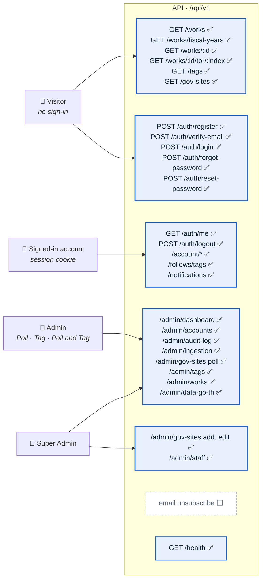
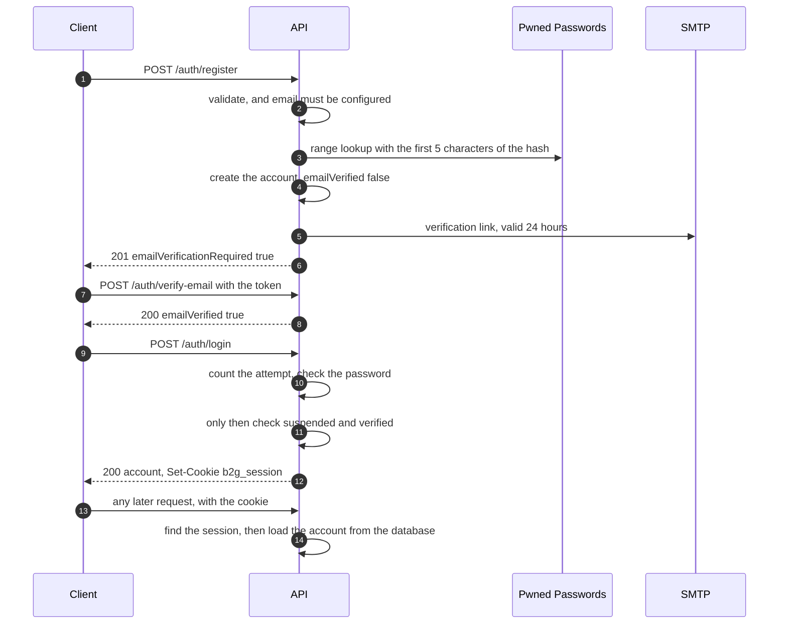
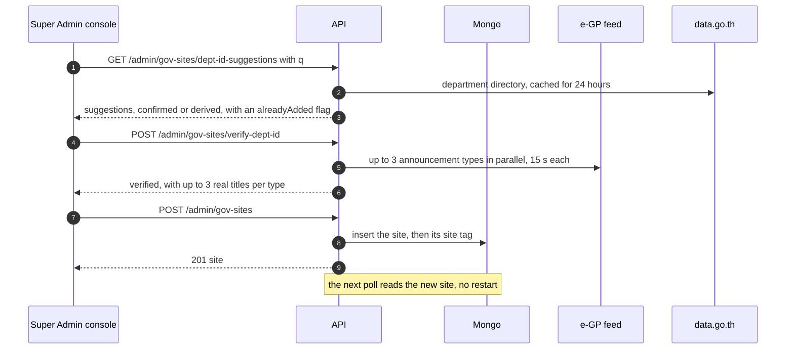
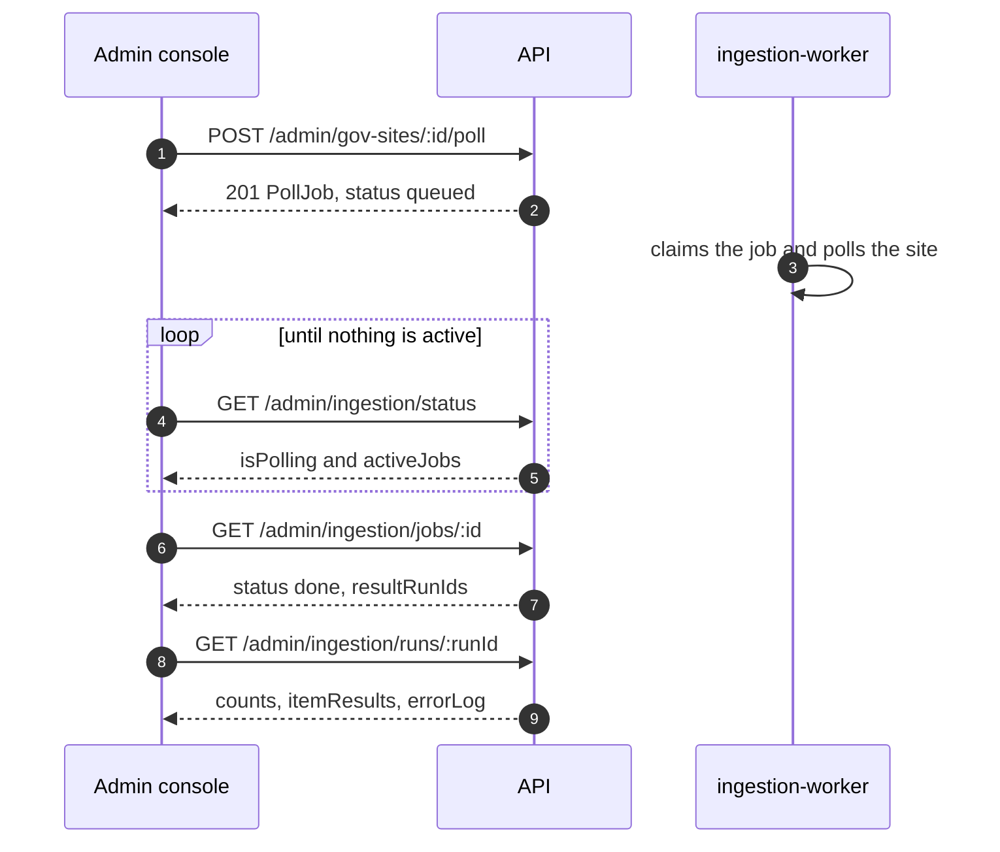

# REST API

The contract between the browser, the admin console, and the API service.

**Legend:** ✅ built and tested · 🔨 partly built · ⬜ designed, not built.

The web app reads the base URL from `NEXT_PUBLIC_API_URL` (default `http://localhost:4000/api/v1`); the
API itself listens on `PORT` (default `4000`). No host is hard-coded in the server.

Every application route lives under **`/api/v1`**. The version is in the path so that a breaking change
to a response shape can be introduced beside the old one as `/api/v2` instead of as a silent edit. The
one route outside it is `GET /health`.

---

## 1. The surface at a glance



| Group | Who calls it | Auth | Use case |
| :--- | :--- | :--- | :--- |
| `/works`, `/works/fiscal-years`, `/works/:id`, `/works/:id/tor/:index` | Anyone | none | 6.2.2 · 6.2.3 · 6.2.4 |
| `/tags`, `/gov-sites` (read) | Anyone | none | 6.2.2 · 6.2.5 |
| `/auth/*` | Anyone; `me` and `logout` need a session | session cookie where noted | 6.2.1 |
| `/account/*` | Any signed-in account | session cookie | 6.2.1 |
| `/follows/*`, `/notifications/*` | Any signed-in account | session cookie | 6.2.5 · 6.2.6 |
| `/admin/*` | Admins, narrowed by role | session cookie + role or permission | 6.2.7 – 6.2.10 |
| `/health` | Docker Compose, monitors | none | — |

---

## 2. Conventions

### The response envelope

Every route except `/health` answers in one shape:

```json
{ "success": true, "data": { } }
```

```json
{ "success": false,
  "error": { "code": "VALIDATION_ERROR", "message": "Please check the highlighted fields.",
             "fields": { "email": "Invalid email address" } } }
```

A creation answers `201` (register, a new site, tag, vendor, admin, or poll job); everything else
answers `200`, including following a tag. `fields` maps a request field to the reason it was refused,
using a dotted path for nested input (`announceTypes.0`). `details` carries machine-readable context
where there is some (the existing tags a new tag collides with, the seconds until an account unlocks).

### Authentication

A signed-in caller carries a **session cookie**, set by `POST /auth/login` and cleared by
`POST /auth/logout`:

| Attribute | Value |
| :--- | :--- |
| Name | `SESSION_COOKIE_NAME`, `b2g_session` by default |
| Flags | `HttpOnly`; `SameSite=Lax` by default (`COOKIE_SAMESITE`); `Secure` in production |
| Lifetime | `SESSION_TTL_DAYS`, 7 by default |
| Value | A random token. The server keeps only its hash, so the session can be revoked |

A browser must send `credentials: 'include'`, and the request must come from an origin listed in
`CORS_ORIGIN`. The role and permissions are **read from the database on every request**, never from the
cookie, so suspending, demoting, or deleting an account takes effect on its next call.

There are three account roles — `user` (a vendor), `admin`, and `superadmin` — and an `admin` holds one
of three permissions, which decide what the admin area lets them do:

| Permission | Name in the app | Opens |
| :--- | :--- | :--- |
| `poll:manage` | Poll Admin | Running polls, the schedule, run history |
| `tag:manage` | Tag Admin | The tag vocabulary and the tags on each work |
| `poll&tag:manage` | Poll and Tag Admin | Both |

An Admin with no permission yet can still use the dashboard, vendor accounts, the audit log, and the
read-only pages. A Super Admin passes every check.

| Area | Visitor | Vendor | Admin, no role | Tag | Poll | Poll and Tag | Super Admin |
| :--- | :---: | :---: | :---: | :---: | :---: | :---: | :---: |
| Public reads (`/works`, `/tags`, `/gov-sites`) | ✅ | ✅ | ✅ | ✅ | ✅ | ✅ | ✅ |
| Own account, follows, notifications | — | ✅ | ✅ | ✅ | ✅ | ✅ | ✅ |
| Dashboard, vendor accounts, audit log, site list, poll status, `data.go.th` explorer, followers of a tag | — | — | ✅ | ✅ | ✅ | ✅ | ✅ |
| Tag vocabulary and the tags on a work | — | — | — | ✅ | — | ✅ | ✅ |
| Poll now, the schedule, run history | — | — | — | — | ✅ | ✅ | ✅ |
| Source configuration: add, edit, enable, disable, verify, suggestions | — | — | — | — | — | — | ✅ |
| Admin accounts (`/admin/staff`) | — | — | — | — | — | — | ✅ |

A request with no valid session answers `401 NOT_AUTHENTICATED`. A signed-in caller without the role
answers `403 FORBIDDEN`, decided **before** the body or the id is looked at. A suspended account answers
`403 ACCOUNT_SUSPENDED`. The admin screens hide what a role cannot use, but that is convenience; the
server is what refuses.

### Cross-site request protection

Every request that changes data (`POST`, `PUT`, `PATCH`, `DELETE`) must pass two checks before it is
even parsed:

1. **Who sent it.** A request carrying an `Origin` must come from an origin in `CORS_ORIGIN`. With no
   `Origin`, a `Sec-Fetch-Site` other than `same-origin` or `none` is refused. A caller that sends
   neither header (curl, a script, another server) is not a browser, so it passes this step.
2. **What it is.** `Content-Type` must be `application/json` — **even when there is no body**.

A failure is `403 CSRF_BLOCKED` or `415 UNSUPPORTED_MEDIA_TYPE`. `GET`, `HEAD`, and `OPTIONS` are not
checked.

### Input

- Bodies and queries are validated against **strict** schemas. An unknown field is a `400
  VALIDATION_ERROR`, never ignored, and nothing is changed when any field is bad.
- Any body key that starts with `$` or contains a `.` is dropped before validation.
- Text is trimmed; emails are lower-cased. The body limit is 1 MB (`413 PAYLOAD_TOO_LARGE`); a body that
  is not JSON is `400 BAD_REQUEST`.
- Numbers in a query string are plain digits (`budgetMin=500000`), not `1e3` or `0x10`.
- Ids are 24-character hexadecimal strings. A route that validates its `:id` answers a malformed one
  with `400 VALIDATION_ERROR`; a well-formed id that matches nothing is `404 NOT_FOUND`. The rest
  answer `404` for either.
- Times are ISO 8601 in UTC. A date-only filter such as `publishedFrom` means a whole **Bangkok** day
  (UTC+07:00).

### Pagination

List routes take `page` (from 1) and `pageSize`, and answer `{ items, total, page, pageSize }`:

| Route | Default `pageSize` | Maximum |
| :--- | :---: | :---: |
| `/works`, `/admin/works`, `/admin/accounts`, `/admin/staff`, `/admin/ingestion/runs` | 20 | 50 |
| `/admin/audit-log` | 25 | 100 |

Every sort ends with `_id`, so two works that tie on the sort value keep a fixed order and never repeat
or vanish between pages. `/admin/accounts` and `/admin/staff` add a `summary` of unfiltered totals.

### Errors

| Status | `code` | Means |
| :--- | :--- | :--- |
| 400 | `VALIDATION_ERROR` | A field failed its rule; `fields` says which and why |
| 400 | `BAD_REQUEST` | The request itself is wrong (broken JSON, passwords that do not match, a breached password) |
| 400 | `TOKEN_INVALID` | An email or reset link that has expired or was already used |
| 401 | `NOT_AUTHENTICATED` | No session, or it expired or was revoked |
| 401 | `INVALID_CREDENTIALS` | Wrong email or password (also a wrong *current* password on change) |
| 403 | `FORBIDDEN` | Signed in, but not allowed here |
| 403 | `ACCOUNT_SUSPENDED` | The account has been suspended |
| 403 | `EMAIL_NOT_VERIFIED` | The password was right, but the email is not verified yet |
| 403 | `CSRF_BLOCKED` | The request did not come from an allowed origin |
| 404 | `NOT_FOUND` | No such record; also a malformed id on a route that does not validate it |
| 409 | `CONFLICT` | The action clashes with current state (a poll already running, a site name, `deptId`, or short code already in use) |
| 409 | `DUPLICATE_TAG` · `NEAR_DUPLICATE_TAG` | A tag with that name exists · a similar one does and the Admin has not confirmed |
| 409 | `REGISTRATION_FAILED` | Sign-up refused, deliberately without saying why |
| 409 | `EMAIL_ALREADY_REGISTERED` | An Admin tried to create an account with a taken email |
| 413 | `PAYLOAD_TOO_LARGE` | The body is over 1 MB |
| 415 | `UNSUPPORTED_MEDIA_TYPE` | A change was not sent as `application/json` |
| 423 | `ACCOUNT_LOCKED` | Too many failed sign-ins; `details.retryAfterSeconds` says when to try again |
| 429 | `RATE_LIMITED` | Too many requests from this address; the `RateLimit` headers say when to retry |
| 500 | `INTERNAL_ERROR` | A server fault. In production the message is fixed text; details go to the log |
| 503 | `SERVICE_UNAVAILABLE` | A dependency is missing: email is not configured, or the password check is down |

A duplicate-key conflict that no service handled itself surfaces as `409 VALIDATION_ERROR` with the
message "That value is already in use."

### Rate limiting and lockout

Three limits count requests **per client address**:

| Route | Limit |
| :--- | :--- |
| `POST /auth/login` | 10 per 15 minutes |
| `POST /auth/register` | 5 per hour |
| `POST /auth/forgot-password` and `/auth/reset-password`, together | 5 per hour |

The standard `RateLimit` and `RateLimit-Policy` headers (IETF draft 7) report what is left. On top of
that, wrong passwords are counted **per account**, wherever they come from, on sign-in and on change
password: the first 4 failures cost nothing; after that the account is locked for 1 minute, then
twice as long after each further failure, up to 30 minutes (`423 ACCOUNT_LOCKED`). A correct sign-in,
or a password reset, clears the count. Failures older than 24 hours are forgotten.

Search and the poll routes are **not** rate-limited yet (SRS §5.3, *Injection and Rate Limiting*).

---

## 3. Sign-up and sign-in ✅ (use case 6.2.1)



| Route | Auth | Purpose |
| :--- | :--- | :--- |
| `POST /auth/register` | none | Creates a self-registered account and emails a verification link |
| `POST /auth/verify-email` | none | `{ token }` — marks the email verified. The link is single-use and lasts 24 hours |
| `POST /auth/login` | none | Starts a session; the cookie is the response's `Set-Cookie` |
| `POST /auth/logout` | session | Revokes the session and clears the cookie |
| `GET /auth/me` | session | The signed-in account |
| `POST /auth/forgot-password` | none | `{ email }` — emails a reset link. Answers `200` with the same message whether or not the email has an account; `500` when email is not configured or the send fails |
| `POST /auth/reset-password` | none | `{ token, newPassword, confirmNewPassword }` — the link is single-use and lasts 1 hour. Ends **every** session of the account and lifts a sign-in lock |

### `POST /auth/register`

```json
{ "name": "Somchai Jaidee", "email": "somchai@example.com", "password": "Passw0rd-example",
  "confirmPassword": "Passw0rd-example", "type": "business",
  "businessProfile": { "companyName": "Example Co., Ltd.", "taxId": "0105500000000" } }
```

```json
{ "success": true, "data": { "emailVerificationRequired": true } }
```

| Field | Rule |
| :--- | :--- |
| `name` | Required, at most 150 characters. Letters, hyphens, and apostrophes, with at most one space |
| `email` | Required, a valid address with no spaces; stored lower-case |
| `password` | At least 8 characters, with a letter and a digit, at most 72 bytes, and not in a known breach |
| `type` | `individual` (default) or `business`. Fixed after sign-up |
| `businessProfile` | Required for `business`: `companyName` (at most 200) and `taxId` (exactly 13 digits) |

An account cannot sign in until its email is verified, so registration needs email to be configured:
without `SMTP_HOST` it answers `503 SERVICE_UNAVAILABLE`. The breached-password check sends only the
first five characters of the password's hash; a password found in a breach is `400 BAD_REQUEST`, and if
that service cannot be reached the answer is `503`. A taken email answers the same generic
`409 REGISTRATION_FAILED` as any other refusal, so the route cannot be used to discover who has an
account.

### `POST /auth/login`

```bash
curl -i -X POST http://localhost:4000/api/v1/auth/login \
  -H "Content-Type: application/json" \
  -c cookies.txt \
  -d '{"email":"somchai@example.com","password":"Passw0rd-example"}'

curl http://localhost:4000/api/v1/auth/me -b cookies.txt
```

The answer is the account (see §5). The checks run in a fixed order so that nothing is revealed before
the password is proved:

1. An unknown email gets `401 INVALID_CREDENTIALS` after the same amount of work as a wrong password.
2. A locked account gets `423 ACCOUNT_LOCKED` without its password being checked at all.
3. A wrong password is `401 INVALID_CREDENTIALS` — identical for an active, a suspended, and a
   missing account.
4. Only with the **right** password: `403 ACCOUNT_SUSPENDED`, then `403 EMAIL_NOT_VERIFIED`.

---

## 4. Public reads ✅ (use cases 6.2.2, 6.2.3, 6.2.4)

No sign-in. A work that the optional topic filter has marked `not-related` is never listed, returned,
or downloadable.

### `GET /api/v1/works`

| Query | Type | Meaning |
| :--- | :--- | :--- |
| `q` | text | Up to 200 characters and 8 words. **Every** word must match the title, the description, or the agency (a site's name, English name, or short code, or an agency tag). Thai has no spaces, so a space is the only sign of separate keywords; a Thai word is matched typo-tolerantly |
| `siteId` | id | One government site |
| `status` | enum | `PLANNED`, `DRAFT_TOR`, `BIDDING`, `CANCELLED`, `AMENDED`, `AWARDED` |
| `tag` | ids | Comma-separated tag ids, at most 30. Tags of the **same** facet match any of them; tags of **different** facets must all match. An id that is well formed but unknown matches nothing |
| `budgetMin`, `budgetMax` | baht | Inclusive, up to two decimals. A work with no price never matches a budget filter. `budgetMin` may not exceed `budgetMax` |
| `publishedFrom`, `publishedTo` | `YYYY-MM-DD` | Inclusive, as Bangkok days. A work with no publish date never matches |
| `fiscalYear` | number | ปีงบประมาณ in the Buddhist Era (2500 – 2700), for example `2569` |
| `sort` | enum | `date` (default, newest first), `budget-asc`, `budget-desc`, `deadline`, `deadline-desc` |
| `page`, `pageSize` | number | `page` from 1, `pageSize` 1 – 50, default 20 |

Different parameters combine with AND. Two sorts are worth knowing: `budget-asc` lists **priced** works
first, so a work with no price never looks like the cheapest; and the two deadline sorts list works
that can still be bid on first (soonest, or furthest away, first), then everything else — no deadline
stated, already closed, cancelled, or awarded — newest first.

```json
{ "success": true,
  "data": {
    "items": [ {
      "_id": "6710c2e4a1b2c3d4e5f60718",
      "siteId": { "_id": "670f9a0b1c2d3e4f5a6b7c8d", "name": "สำนักงานปลัดกระทรวงสาธารณสุข", "shortCode": "MOPH" },
      "projectId": "69109012345",
      "title": "ประกาศเชิญชวนจัดซื้อระบบสารสนเทศ",
      "description": "สรุปขอบเขตงานจากเอกสาร TOR",
      "status": "BIDDING", "announceType": "D0",
      "pubDate": "2026-10-20T03:00:00.000Z",
      "budget": 1250000,
      "fiscalYear": 2569, "fiscalYearSource": "document",
      "deadlineAt": "2026-11-03T09:30:00.000Z", "deadlineHasTime": true,
      "tags": [ { "_id": "670f9a0b1c2d3e4f5a6b7c90", "name": "สำนักงานปลัดกระทรวงสาธารณสุข", "facet": "site" } ],
      "torFiles": [ ], "statusHistory": [ ],
      "createdAt": "2026-10-20T04:11:08.000Z", "updatedAt": "2026-10-20T04:11:08.000Z" } ],
    "total": 1, "page": 1, "pageSize": 20 } }
```

### `GET /api/v1/works/fiscal-years`

The fiscal years that actually have works, newest first, so a filter never offers an empty choice:
`[ { "year": 2569, "count": 41 } ]`.

### `GET /api/v1/works/:id`

One work, with the same fields as a list item, plus its whole `torFiles` and `statusHistory`:

| Field | Meaning |
| :--- | :--- |
| `_id`, `projectId` | The record, and the e-GP project id it is keyed on (unique per site) |
| `siteId` | `{ _id, name, shortCode }` of the government site |
| `title`, `description` | The announcement title, and an AI-written summary of the TOR (at most 2000 characters; absent when no document was read or AI is off) |
| `status`, `announceType`, `pubDate` | The current status, the e-GP code of its latest announcement, and when it was published |
| `statusHistory[]` | Every announcement once, oldest first: `{ status, announceType, changedAt }`. The last entry is the current status |
| `torFiles[]` | The documents: `{ announceType, linkType, sourceUrl, storageKey?, filename?, downloadedAt?, role?, supersededAt? }`. `linkType` is `pdf`, `zip`, `html`, or `other`; `role` is `primary` or `attachment`; `supersededAt` marks a document replaced by a newer one of the same type |
| `budget` | A reference price (ราคากลาง / วงเงิน), or the **winning bid** when `budgetBasis` is `awarded`. Absent when unknown, never `0` |
| `budgetBasis` | `awarded` when `budget` is a winning bid, otherwise absent |
| `budgetMissingReason` | Only without a price: `not-stated`, `unreadable` (a scan), or `no-document` |
| `contractNumber`, `contractDate`, `winnerName`, `winnerTin`, `enrichedAt` | After award, from `data.go.th` |
| `fiscalYear`, `fiscalYearSource` | The fiscal year, and whether a `document` stated it or it was `estimated` from the project number |
| `deadlineAt`, `deadlineStartAt`, `deadlineHasTime` | The bid-submission window, from the invitation; `deadlineHasTime` is false when only a date was stated |
| `tags[]` | `{ _id, name, facet }` |

An unknown id, and a work hidden from the public site, answer the **same** `404 NOT_FOUND`: "This work
is no longer available." A malformed id is `400`.

#### Work status

| `status` | e-GP codes | Meaning |
| :--- | :--- | :--- |
| `PLANNED` | `P0`, `15` | Procurement plan, reference price |
| `DRAFT_TOR` | `B0` | Draft TOR published |
| `BIDDING` | `D0` | Invitation to bid |
| `AMENDED` | `D2`, `W2` | Modified, or winner modified |
| `CANCELLED` | `D1`, `W1` | Cancelled, or winner cancelled |
| `AWARDED` | `W0` | Winner announced |

A work's status is that of its **latest announcement by publish date**, not of the one read last. No
route writes it; it can only come from a poll.

### `GET /api/v1/works/:id/tor/:index`

Downloads one TOR file as a PDF. `index` is the position in the work's `torFiles` array.

| Header | Value |
| :--- | :--- |
| `Content-Type` | `application/pdf`, always — never taken from the remote file's name |
| `Content-Disposition` | `attachment`, with a safe `.pdf` file name |
| `X-Content-Type-Options` | `nosniff` |

Only genuine PDFs are stored and served. Every refusal is `404 NOT_FOUND`, with a message that says
why: no file at that index; the link is a page on the government site and not a file (follow
`sourceUrl`); the file has not been downloaded yet; or the stored file is missing or is not a PDF. A
malformed id or index is `400`.

### `GET /api/v1/tags`

`?facet=` (`site`, `agency`, `method`, `category`, `keyword`) and `?includeRetired=true`. Answers a plain
array of `{ _id, name, facet, aliases, siteId?, retired, includeInIngestionFilter, createdAt,
updatedAt }`, ordered by facet then name. Retired tags are left out unless asked for.

### `GET /api/v1/gov-sites` · `GET /api/v1/gov-sites/:id`

The government site directory: each site's `name`, `nameEn`, `shortCode`, `deptId`, `announceTypes`,
`enabled`, its polling settings, and (in the list) `worksCount` — counted the way the public search
lists works. The detail route answers the site alone; a malformed id is `400`, an unknown one `404`.

### `GET /health` ✅

`{ "status": "ok", "db": "connected", "timestamp": "2026-11-11T14:30:00.000Z" }` — **not** wrapped in the
envelope. `db` is `disconnected` when the database connection is down. Used by Docker Compose and
monitors.

---

## 5. Signed-in account ✅ (use cases 6.2.1, 6.2.5, 6.2.6)

All routes here need a session.

### The account

`POST /auth/login`, `GET /auth/me`, and `GET`/`PATCH /account/profile` answer the account:

```json
{ "id": "670f9a0b1c2d3e4f5a6b7c10", "email": "somchai@example.com", "name": "Somchai Jaidee",
  "phone": "081-234-5678", "type": "business",
  "businessProfile": { "companyName": "Example Co., Ltd.", "taxId": "0105500000000" },
  "role": "user", "permissions": [], "status": "active", "emailVerified": true,
  "emailNotificationsEnabled": true, "notificationFrequency": "instant",
  "createdAt": "2026-10-01T02:00:00.000Z", "updatedAt": "2026-10-01T02:00:00.000Z" }
```

The password hash, the sign-in lock fields, and the internal id are never included.

| Route | Purpose |
| :--- | :--- |
| `GET /account/profile` | The account, as above |
| `PATCH /account/profile` | Any of `name`, `phone` (a Thai number, `+66` or `0` first), `businessProfile` (`companyName`, 13-digit `taxId`). **Email and account type cannot be changed.** Strict: an unknown field is `400` |
| `GET /account/session` | The account's most recently active session: browser, OS, masked IP address, last-active time |
| `GET /account/notification-settings` | `{ emailNotificationsEnabled, notificationFrequency, pausedTagIds }` |
| `PATCH /account/notification-settings` | `{ emailNotificationsEnabled?: boolean, notificationFrequency?: "instant" or "daily" }` |
| `POST /account/change-password` | `{ currentPassword, newPassword, confirmNewPassword }`. The current password is checked against the sign-in lock, so a stolen session cannot guess it without limit. Ends **every other** session; the current one stays |

### Following tags (use case 6.2.5)

| Route | Purpose |
| :--- | :--- |
| `GET /follows/tags` | The tags the account follows, as full tag objects, ordered by facet then name |
| `POST /follows/tags/:tagId` | Follows a tag; answers the follow `{ _id, accountId, tagId, paused, … }`. Following twice changes nothing. A retired or unknown tag is `404` |
| `DELETE /follows/tags/:tagId` | Unfollows. Answers `{ "unfollowed": true }` even when the tag was not followed, or has since been retired, so a double click or a retry is harmless. Only an id that belongs to no tag is `404` |
| `PATCH /follows/tags/:tagId/pause` | Exactly `{ "paused": true or false }`. A paused follow stays followed but produces no in-app entry and no email. `404` if the account does not follow the tag, so this cannot be used to follow |
| `GET /follows/tags/:tagId/followers` | **Admin.** The active accounts that follow a tag |

### Notifications (use case 6.2.6)

A notification is created when a new work, or a tag newly added to a work, matches a tag the account
follows. There is **at most one per work per account**: a later match refreshes the entry and does not
send a second email. The in-app entry is always created; the email is sent only when the account is
verified, has email on, and is on the `instant` frequency (a `daily` account gets one digest at 08:00
server time).

| Route | Purpose |
| :--- | :--- |
| `GET /notifications` | The latest 100, newest first |
| `PATCH /notifications/:id/read` | Marks one read; answers it. Another account's id is `404` |
| `POST /notifications/read-all` | Marks every one read; answers `{ "updatedCount": 3 }` |

```json
{ "id": "6710d0a1a1b2c3d4e5f60731", "workId": "6710c2e4a1b2c3d4e5f60718",
  "workTitle": "ประกาศเชิญชวนจัดซื้อระบบสารสนเทศ", "agencyName": "สำนักงานปลัดกระทรวงสาธารณสุข",
  "budget": 1250000, "method": "D0", "status": "BIDDING", "statusLabel": "BIDDING",
  "matchedTags": ["สำนักงานปลัดกระทรวงสาธารณสุข"],
  "ingestedDate": "2026-10-20T04:11:08.000Z", "read": false }
```

`budget` is the work's **current** price, not a copy taken when the notification was made (prices arrive
late), and is `null` rather than `0` when unknown. `status` here is the notification's own vocabulary:
`INVITATION` (planned or draft TOR), `BIDDING`, `EVALUATION` (amended), `AWARDED`, `CANCELLED`.

### Email unsubscribe ⬜

A signed link in every notification email that switches email off without signing in (SRS FR-3.7). Not
built: the `/unsubscribe/[token]` page exists in the web app but does not call the API yet, and the
emails carry no token. Today a user turns email off with `PATCH /account/notification-settings`.

---

## 6. Admin ✅ (use cases 6.2.7 – 6.2.10)

Every route is under `/api/v1/admin`, and needs a session whose role is `admin` or `superadmin`
(`401` without a session, `403` for a vendor). The table in §2 shows what each role may open. Every
change an Admin makes is written to the audit log (§6.1).

### 6.1 Dashboard and audit log ✅ (any Admin)

| Route | Purpose |
| :--- | :--- |
| `GET /admin/dashboard` | One read-only snapshot, computed live: accounts, tags, sites, works, and ingestion |
| `GET /admin/audit-log` | The audit trail, paged. Query: `actor`, `action` (comma-separated), `entityType` (comma-separated), `entityId`, `from`, `to`, `q`, `sort` (`newest` or `oldest`), `page`, `pageSize` |
| `GET /admin/audit-log/filters` | The distinct actions, entity types, and actors that exist, for the filter lists |
| `GET /admin/audit-log/:id` | One entry, with **every** change (the list cuts a long one short) |

```json
{ "generatedAt": "2026-11-11T14:30:00.000Z",
  "accounts": { "vendors": { "total": 12, "active": 11, "suspended": 1 },
                "admins":  { "total": 4, "admin": 3, "superadmin": 1, "suspended": 0 } },
  "tags": { "active": 86, "retired": 3, "byFacet": { "site": 4, "agency": 7, "method": 5, "category": 40, "keyword": 30 } },
  "sites": { "total": 4, "enabled": 4 },
  "works": { "total": 903, "visible": 880, "hidden": 23 },
  "ingestion": { "lastRun": null, "failedRuns24h": 0, "runningNow": 0, "queuedJobs": 0,
                 "nextScheduledAt": "2026-11-12T02:00:00.000Z", "scheduleEnabled": true,
                 "pollIntervalMinutes": 1440, "sites": [ ] } }
```

An audit entry records who did it (a snapshot, so it survives that account's deletion), what changed
field by field (before and after), the masked IP address, the user agent, and a request id that groups
every row one request wrote. Any field whose name contains `password`, `token`, `hash`, `secret`,
`apikey`, `authorization`, or `credential` is stored as `[REDACTED]`. The log is **append-only**: there
is no `POST`, `PATCH`, `PUT`, or `DELETE` on it, and the model refuses edits and deletes. Entries about
staff accounts are visible to a Super Admin only.

### 6.2 Vendor accounts ✅ (any Admin · use case 6.2.10)

Only ever acts on vendor accounts: an Admin or Super Admin id is reported as `404`.

| Route | Purpose |
| :--- | :--- |
| `GET /admin/accounts?q=&status=&type=&sort=&page=&pageSize=` | Vendors. `q` searches name, email, company name, and tax id; `status` is `active` or `suspended`; `type` is `individual` or `business`; `sort` is `newest`, `oldest`, or `name`. Also answers `summary: { total, active, suspended }` |
| `POST /admin/accounts` | `{ name, email, phone?, type, businessProfile? }` → `201 { vendor, setupEmail }`. **No admin ever chooses a password**: a random one is set, and the vendor is emailed a link (valid 1 hour) to choose their own. `setupEmail` is `{ sent, reason? }`, with `reason` `smtp_not_configured` or `send_failed` |
| `GET /admin/accounts/:id` | One vendor, with `followedTagsCount` and `lastActiveAt` |
| `PATCH /admin/accounts/:id` | `{ name?, phone? (null clears it), businessProfile? }`. Email and account type are identity and cannot change; a business profile only on a business account |
| `PATCH /admin/accounts/:id/suspend` · `/reactivate` | Suspending ends every session at once, so a later reactivation does not bring old sign-ins back |
| `POST /admin/accounts/:id/password-link` | Sends the vendor a fresh set-or-reset link. Refused for a suspended account |
| `DELETE /admin/accounts/:id` | **Permanent.** Removes the account, its sessions, follows, notifications, and outstanding links. Answers `{ id, email }` |

### 6.3 Admin accounts ✅ (Super Admin only)

The whole `/admin/staff` router is Super Admin only; an Admin gets `403`.

| Route | Purpose |
| :--- | :--- |
| `GET /admin/staff?q=&status=&role=&sort=&page=&pageSize=` | Admins and Super Admins. `role` is `admin` or `superadmin` |
| `POST /admin/staff` | `{ name, email, phone?, permission }` with `permission` one of `poll:manage`, `tag:manage`, `poll&tag:manage` → `201 { admin, setupEmail }`. Only plain Admins are ever created |
| `GET /admin/staff/:id` | One staff account: `{ id, name, email, role, permission, status, lastActiveAt, activeSessions, manageable, … }` |
| `PATCH /admin/staff/:id` | `{ name?, phone? (null clears it), permission? }`. A new permission applies on that Admin's very next request |
| `PATCH /admin/staff/:id/suspend` · `/reactivate` | Suspending signs the Admin out everywhere |
| `POST /admin/staff/:id/sign-out` | Ends every session without suspending — a lost laptop. Answers `{ revoked }` |
| `POST /admin/staff/:id/password-link` | Sends a set-or-reset link |
| `DELETE /admin/staff/:id` | **Permanent**, with the same cascade as a vendor |

A **Super Admin is listed but read-only** (`manageable: false`): every change, sign-out, and delete of
one answers `403 FORBIDDEN`. There is no route that creates or promotes a Super Admin; that stays a
deliberate act outside the panel (`npm run seed:superadmin`).

### 6.4 Source configuration ✅ (Super Admin only · use case 6.2.8)

A government site is polled through its e-GP **department code** (`deptId`). Adding a site also creates
its followable `site` tag, named after the site.



| Route | Auth | Purpose |
| :--- | :--- | :--- |
| `GET /admin/gov-sites` | any Admin | Every site, with `worksCount`, its latest `lastRun`, `effectiveIntervalMinutes`, and `nextRunAt` (`null` when the site is disabled or the schedule is paused) |
| `POST /admin/gov-sites` | Super Admin | Adds a site → `201` with the site |
| `PATCH /admin/gov-sites/:id` | Super Admin | Edits, enables, disables, or repoints a site |
| `POST /admin/gov-sites/verify-dept-id` | Super Admin | Live check of a candidate code against the real feed |
| `GET /admin/gov-sites/dept-id-suggestions` | Super Admin | Agencies matching what has been typed |

There is **no delete route**: a site is retired by disabling it, which keeps its works and its history.

#### Fields

| Field | Rule |
| :--- | :--- |
| `name` | Required, at most 200 characters, no control characters or line breaks. **Unique**, because the site's tag is named after it |
| `nameEn` | Optional, at most 200 characters |
| `shortCode` | Required, at most 20 characters: letters, digits, `.`, `-`, `_`, starting with a letter or digit. Stored upper-case. **Unique** |
| `deptId` | Required, **digits only, 1 to 10** (`2102`, `0806`, `4520101`). **Unique** |
| `announceTypes` | Optional, default `["B0","D0"]`. At least one, each once, from `P0`, `15`, `B0`, `D0`, `W0`, `D1`, `W1`, `D2`, `W2` |
| `dataGoThOrgSlug`, `dataGoThResourceId`, `dataGoThPackageId` | Optional, at most 100 characters: letters, digits, `.`, `-`, `_` |
| `dataGoThSearchQuery` | Optional, at most 200 characters; a raw CKAN `package_search` query |
| `requestsPerMinute` | Whole number 1 – 600, default 60 |
| `pollIntervalMinutes` | Optional own interval: 120 (2 hours) to 43200 (30 days). Without it the global schedule applies |
| `enabled` | `PATCH` only. `false` takes the site out of the schedule and out of "poll all", and it cannot be polled by hand |

`PATCH` takes any of these, at least one. Sending `null` for `pollIntervalMinutes` or any `dataGoTh…`
setting **clears** it. The update is atomic: if one field is bad, nothing is saved, not even a valid
field sent beside it. Renaming a site renames its tag in the same step (the tag keeps its id, so
followers stay) and updates the tag's short-code alias.

A clash answers `409 CONFLICT` naming the field **and the site that holds it**, in `fields`:
`{ "deptId": "สำนักงานปลัดกระทรวงสาธารณสุข (MOPH) already uses this deptId." }`.

A change applies from the **next poll** with no restart: a poll reads the site's current `deptId`,
announcement types, and request rate when it starts.

#### `POST /admin/gov-sites/verify-dept-id`

Read-only. Nothing is saved.

```json
{ "deptId": "2102", "announceTypes": ["B0", "D0"] }
```

```json
{ "deptId": "2102", "checkedAt": "2026-11-11T14:30:00.000Z", "totalItems": 18, "verified": true,
  "results": [ { "announceType": "B0", "itemCount": 10, "sample": ["…", "…", "…"] },
               { "announceType": "D0", "itemCount": 8,  "sample": ["…", "…", "…"] } ] }
```

`announceTypes` is optional (default `B0` and `D0`), at most three, each once. `verified` means at
least one type returned a real announcement; the sample titles let an Admin see it is the right
agency, since a wrong code can still return something. A type that fails or does not answer within
15 seconds reports an `error` on its own entry and does not hide the others. A `deptId` that is not
digits is refused with `400` without contacting the feed.

#### `GET /admin/gov-sites/dept-id-suggestions?q=&limit=`

`q` is digits (a code prefix, 1 – 5) or part of an agency name in Thai or English; `limit` is 1 – 20.
A text query that is too short answers an empty list without contacting `data.go.th`.

```json
{ "query": "highways",
  "suggestions": [ { "deptId": "0806", "name": "กรมทางหลวง", "nameEn": "Department of Highways",
                     "shortCode": "DOH-highway", "ministry": "กระทรวงคมนาคม", "confidence": "confirmed",
                     "alreadyAdded": { "siteId": "670f…", "name": "กรมทางหลวง", "shortCode": "DOH-HIGHWAY" } } ],
  "directory": { "status": "ok", "loadedAt": "2026-11-11T14:00:00.000Z", "agencies": 153 } }
```

`confidence` is `confirmed` for the built-in agencies whose codes the team checked against the live
feed, and `derived` for codes converted from the Ministry of Finance department list, which are
probably right but unproven — **Verify live** is what proves one. `alreadyAdded` is present when a
site already uses the code, so adding it again would fail. When the directory cannot be loaded the
answer is still `200`: `directory.status` is `stale` (the last good copy is used) or `unavailable`
(only the built-in agencies can be suggested), and a failed load is not retried for a minute.

### 6.5 Polling and ingestion ✅ (use case 6.2.7)

Polling needs the **Poll** role (Poll Admin, Poll and Tag Admin, or Super Admin).



| Route | Auth | Purpose |
| :--- | :--- | :--- |
| `POST /admin/gov-sites/:id/poll` | Poll | `{ source?: "rss" or "data_go_th" or "both" }` (default `both`) → `201` with the `PollJob` |
| `POST /admin/gov-sites/poll-all` | Poll | Polls every enabled site → `201` with the `PollJob` |
| `GET /admin/ingestion/status` | any Admin | `{ isPolling, activeJobs[] }` — whether a poll is queued or running right now, for **every** admin |
| `GET /admin/ingestion/jobs/:id` | Poll | One `PollJob`: `status` (`queued`, `running`, `done`, `failed`), `resultRunIds`, `error` |
| `GET /admin/ingestion/runs?siteId=&source=&status=&startDate=&endDate=&page=&pageSize=` | Poll | Run history, newest first. `source` is `rss` or `data_go_th`; `status` is `running`, `success`, `partial`, or `failed`; dates are `YYYY-MM-DD` |
| `GET /admin/ingestion/runs/:id` | Poll | One run: `fetchedCount`, `newCount`, `updatedCount`, `failedCount`, `itemResults[]` (`title`, `projectId`, `announceType`, `status`, `message`), `errorLog[]` |
| `GET /admin/ingestion/settings` | Poll | The automatic schedule |
| `PATCH /admin/ingestion/settings` | Poll | `{ pollIntervalMinutes?, scheduleEnabled? }`, at least one |

A poll request is answered **at once** with the queued job — the API never polls; the worker does.
**One poll at a time, for everyone:** while any job is queued or running, a new request is
`409 CONFLICT`. A request for a disabled site is `400`; "poll all" with no enabled site is `400`.

A job that gets no heartbeat for 2 minutes is treated as abandoned and closed as `failed`, and a queued
job nobody claimed for an hour is closed too, so a dead worker can never lock the button for everyone.

```json
{ "pollIntervalMinutes": 1440, "scheduleEnabled": true,
  "minIntervalMinutes": 120, "maxIntervalMinutes": 43200, "defaultIntervalMinutes": 1440,
  "nextRunAt": "2026-11-12T02:00:00.000Z", "updatedAt": "2026-11-10T09:00:00.000Z" }
```

`pollIntervalMinutes` is 120 (2 hours) to 43200 (30 days); the bounds travel with the response so the
screen validates against exactly what the API enforces. `scheduleEnabled: false` pauses the **automatic**
schedule; Poll Now keeps working. `nextRunAt` is `null` while paused or when no site is enabled.

### 6.6 Tag vocabulary and the tags on a work ✅ (Tag role · use case 6.2.9)

Needs the **Tag** role (Tag Admin, Poll and Tag Admin, or Super Admin).

| Route | Purpose |
| :--- | :--- |
| `GET /admin/tags?facet=&includeRetired=&search=` | Every tag as a plain array, with `worksCount` and `followerCount`. `facet` is `site`, `agency`, `method`, `category`, or `keyword` |
| `POST /admin/tags/check-duplicates` | `{ name, aliases?, facet?, excludeId? }` → `{ exact[], similar[] }`, a live check while the Admin is still typing |
| `POST /admin/tags` | `{ name, facet, aliases?, includeInIngestionFilter?, confirmNearDuplicate? }` → `201`. `facet` is `agency`, `method`, `category`, or `keyword` — a site tag cannot be created by hand |
| `PATCH /admin/tags/:id` | `{ name?, aliases?, confirmNearDuplicate? }`, at least one. The tag keeps its id, so works and followers stay attached. A retired tag must be reactivated first |
| `PATCH /admin/tags/:id/retire` · `/reactivate` | Retiring hides a tag from new follows and new works but deletes nothing. Reactivating re-checks for a name clash |
| `PATCH /admin/tags/:id/ingestion-filter` | `{ value: boolean }` — marks a tag as an in-scope topic for the optional topic filter |
| `GET /admin/works?q=&siteId=&tag=&visibility=&page=&pageSize=` | Works for tag editing, newest-updated first, **including** works the topic filter hides. `visibility` is `visible` or `hidden`; `q` matches title or project id |
| `GET /admin/works/:id` | `{ work, ingestionFilter: { active, inScopeTagIds } }`, so the screen can warn before a save would hide or reveal the work |
| `PUT /admin/works/:id/tags` | `{ tagIds: [...] }` (at most 50) replaces the work's tags. Answers `{ work, added[], removed[], relevance: { from, to } }` |

Tag rules:

- **No merge, and no delete.** A duplicate is retired, not merged, so a follow or a work never points
  at nothing.
- **Names and aliases are unique** within their facet, including against retired tags. A clash is
  `409 DUPLICATE_TAG` with `details.matches`. A name that merely *looks like* an existing one is
  `409 NEAR_DUPLICATE_TAG`; resend with `"confirmNearDuplicate": true` to keep both.
- **A site tag follows its site.** It cannot be created, renamed, or retired here: rename or disable
  the site in source configuration instead (`400`).
- **Editing a work's tags:** its own site's tag is always kept and no other site's can be added; a
  retired tag cannot be newly added; and a tag taken off is remembered, so the next poll does not put
  it back. Followers are **not** notified by a manual correction.

### 6.7 `data.go.th` explorer ✅ (any Admin)

A read-only pass-through to the open-data catalog's own API, for finding the current resource id of a
dataset to put in a site's `dataGoTh…` settings. It changes nothing.

| Route | Purpose |
| :--- | :--- |
| `GET /admin/data-go-th/search?q=&rows=&sort=` | Finds datasets by a raw CKAN query (`rows` 1 – 50) |
| `GET /admin/data-go-th/packages/:packageId` | One dataset and its resources |
| `GET /admin/data-go-th/datastore/:resourceId?limit=&offset=&filters=` | Samples a resource's records (`limit` 1 – 100; `filters` is a JSON object such as `{"win_tin":"…"}`) |

---

## 7. Rules that hold across the whole API

1. **Status is never edited.** A work's status comes only from an e-GP announcement; the one route that
   writes to a work is the tag editor, and it refuses a status.
2. **The API never polls.** It only queues a job; the worker does the work, one poll at a time.
3. **The server is the gate.** A role or permission is checked on the server, from the database, on every
   request, and before the body or the id is looked at. Hiding a button is never the control.
4. **A request that changes data must prove where it came from** and be `application/json`, before it
   is parsed.
5. **Input is strict.** Unknown fields are refused, `$` and dotted keys are dropped, and a request with
   any bad field changes nothing.
6. **Secrets are never returned or stored in a replayable form.** Passwords, session tokens, and link
   tokens are stored hashed; the account response omits the hash and the lock fields.
7. **Sign-in reveals nothing early.** Unknown email, wrong password, and a suspended account's wrong
   password all answer alike; only the right password is told the account is suspended or unverified.
8. **A price is never `0`.** It is a number, or absent with a reason, and a winning bid says so.
9. **Nothing is deleted by accident.** Tags and sites are retired or disabled, never removed; the audit
   log is append-only; the only permanent deletes are an account, explicitly, by an Admin.
10. **Every admin change is audited**, with who, what, before and after, and when.
