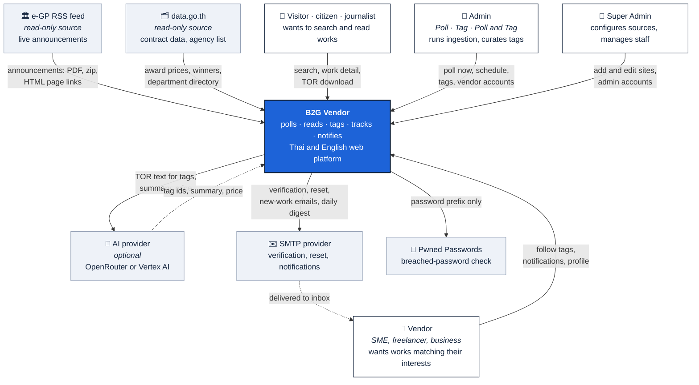
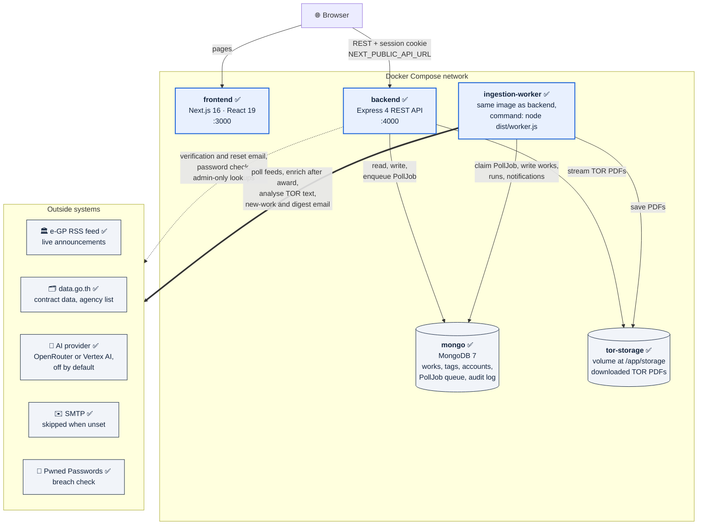
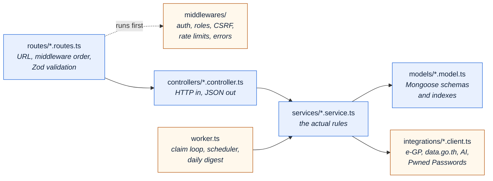
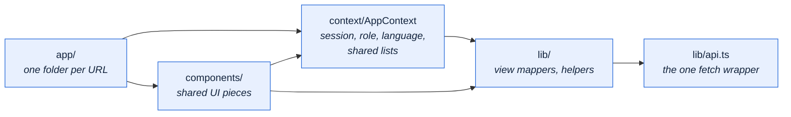
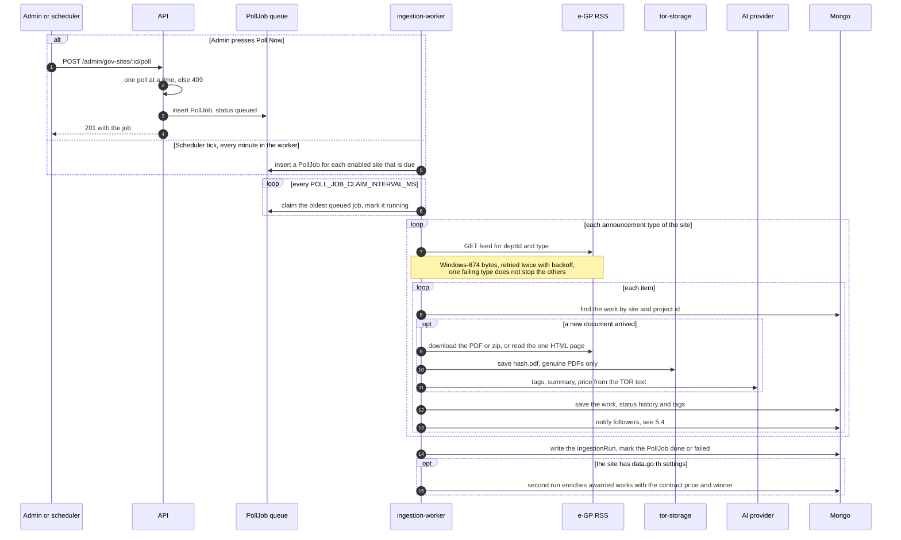
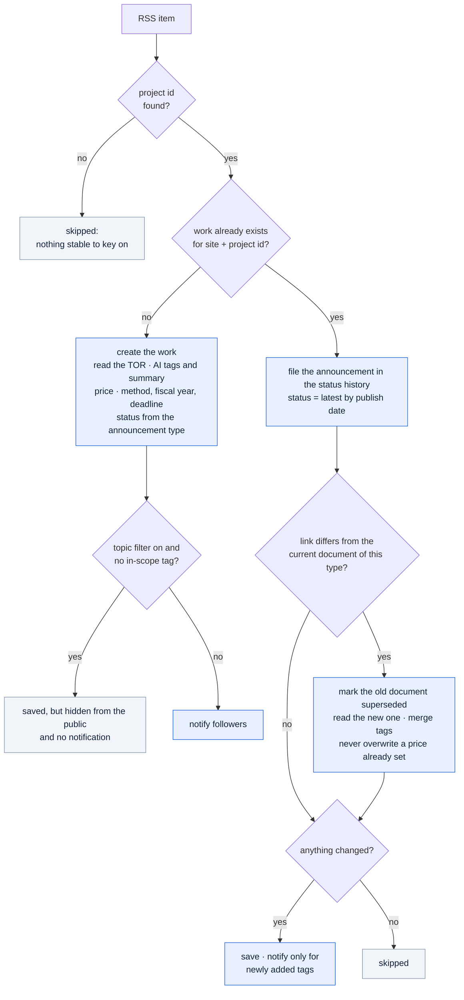
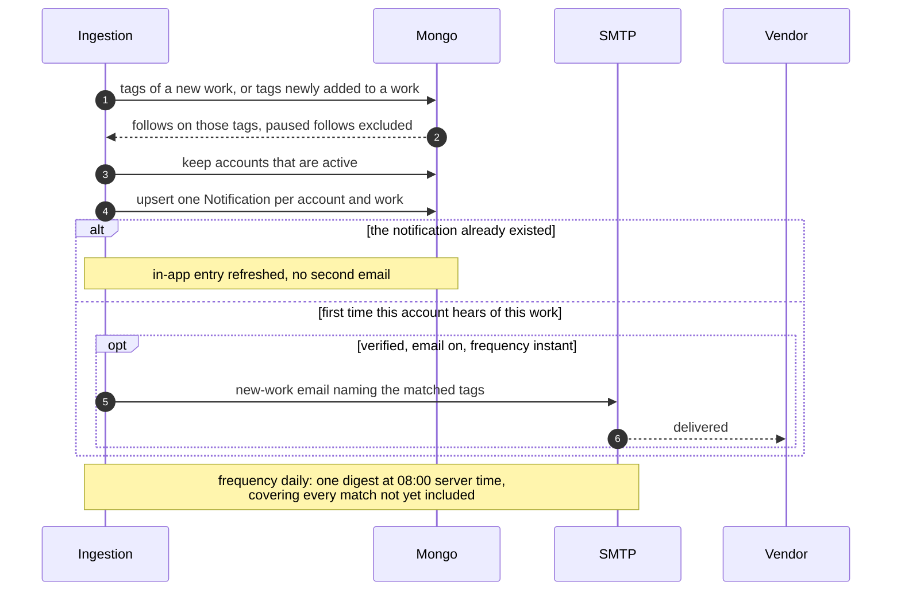
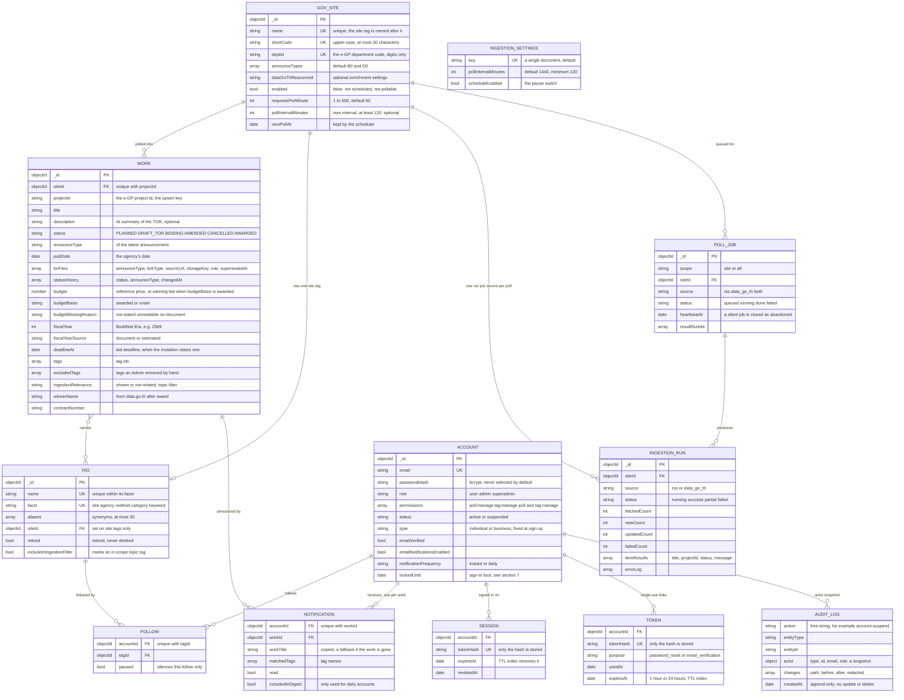
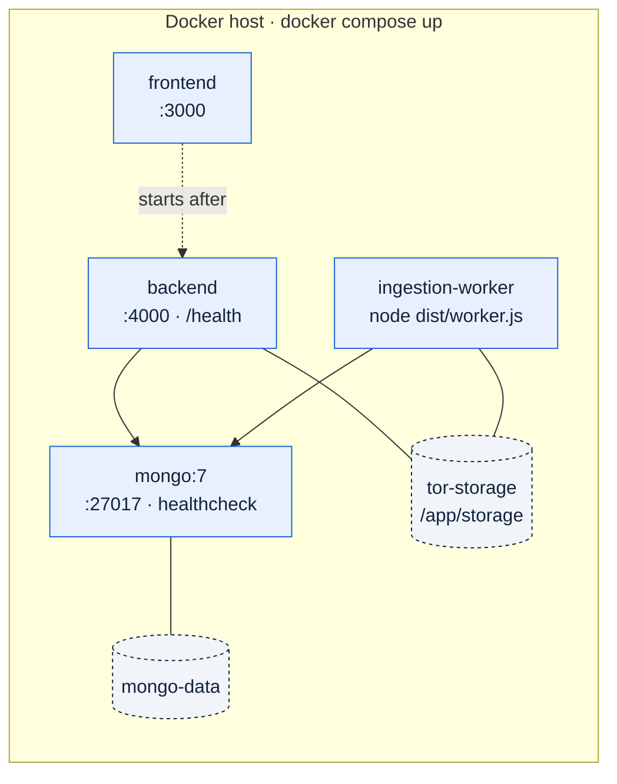

# Architecture

How B2G Vendor is put together: what the pieces are, where each kind of code lives, how a government
announcement travels through the system, and which rules must stay true.

This document answers *where* — where does this behaviour live, where does a change belong. It does
not restate *what* the system must do (that is [SRS.md](../SRS.md)), *why* the project exists
([ProjectDescription.md](ProjectDescription.md)), or the exact request and response of each route
(that is [API.md](API.md)). It is deliberately short and changes only a few times a year, per the
[ARCHITECTURE.md convention](https://matklad.github.io/2021/02/06/ARCHITECTURE.md.html).

**Legend used throughout:** ✅ built · 🔨 partly built (the SRS marks it *Partial*) · ⬜ planned.

---

## 1. The problem, in four sentences

Thai government agencies publish procurement announcements — draft Terms of Reference (TOR),
invitations to bid, winner announcements — through the e-GP system, as RSS entries that point to
PDFs, zip archives, or HTML pages, with no single place to watch them all. A vendor cannot practically
follow dozens of agencies, and a citizen cannot practically see what is being bought. B2G Vendor polls
the agencies a Super Admin has configured, downloads and reads each TOR, tags and summarises it (with
AI, optionally), tracks the work through its lifecycle, and tells the vendors who follow a matching
interest tag, in the app and by email. Anyone can search, filter, read, and download TORs without
signing in, and every status shown comes from an agency announcement, never from a manual edit.

---

## 2. System context

Who and what the system talks to. (C4 level 1 — [c4model.com](https://c4model.com).)

Boundaries worth stating out loud, because they are easy to assume wrongly:

- **Government sites are a source, not users.** Nothing is submitted to them and there is no agency
  login. The system reads the e-GP feed and `data.go.th`; the single exception to "no HTML" is the one
  announcement page an RSS item itself links to, read for its price (SRS FR-2.3a).
- **AI is best-effort and optional.** With it off, or failing, ingestion still stores every work —
  title-only classification, no summary. It is never a blocking dependency.
- **Status is never edited by hand.** It is derived from the e-GP announcement type. The only thing
  an Admin edits on a work is its tags.
- **Two notification channels:** the in-app notification center (always on) and email (verified
  accounts that have not switched it off).

---

## 3. Containers

The runnable pieces and how they talk. (C4 level 2.)

**Why the worker is its own service rather than a thread in the API:** restarting or redeploying the
API must not kill a poll in flight, and a failing poll should be visible in its own logs. The two
never call each other. "Poll Now" only inserts a `PollJob` row; the worker claims it atomically
(`findOneAndUpdate` on `status: queued`) and does the work. That row is also the single source of
truth for "a poll is running", so every admin sees the same locked button, and it survives a page
refresh. The worker shares the API image and differs only by command, so this costs one Compose
entry, not a second codebase.

**Why the browser talks to the API directly:** the frontend is a client-side Next.js app. Every page
calls the API through one wrapper (`lib/api.ts`) with `credentials: 'include'`, so the session cookie
is the API's own. That is why CORS lists the frontend origins exactly (`CORS_ORIGIN`), why every
state-changing request is checked for an allowed `Origin` and a JSON body (CSRF), and why the
frontend's Content-Security-Policy allows `connect-src` to the API origin and nothing else.

**The storage seam:** TOR PDFs are written by the worker and read by the API, so both mount the same
`tor-storage` volume. The browser never gets a storage path — it asks the API for
`/works/:id/tor/:index`, which checks the file is a genuine PDF before sending it. All storage code is
in one file (`services/fileStorage.service.ts`), so moving to an object-storage bucket later means
rewriting that file, not the pipeline. The honest cost: today the API and the worker must share a
disk.

---

## 4. Codemap

Where each kind of code lives, and — as importantly — what each folder is not supposed to do.

### Repository root

| Path | Holds | Rule |
| :--- | :--- | :--- |
| `B2GVendor/` | Next.js frontend | Pages in `src/app/`, shared pieces in `src/components/` and `src/lib/` |
| `Backend/` | Express API **and** the ingestion worker | One image, two entry points: `server.ts` and `worker.ts` |
| `testAPI/` | Exploration scripts for the real e-GP feed and `data.go.th` | Not part of the shipped app; nothing imports it |
| `docs/` | This file, [API.md](API.md), the [requirements description](ProjectDescription.md) | — |
| `SRS.md` | The requirements, with a *Current* and *Next* note per requirement | The source of truth for *what*; kept in step with the code |
| `docker-compose.yml` | `mongo`, `backend`, `ingestion-worker`, `frontend` | Ports and API URL come from the root `.env` |

### `Backend/src/`

| Path | Holds | Rule |
| :--- | :--- | :--- |
| `app.ts` · `server.ts` · `worker.ts` | The Express app and its middleware order · the API process · the worker process | `import './audit/install'` stays the **first** import of `app.ts` and `worker.ts`: the audit plugin only covers models compiled after it |
| `config/` | `env.ts` (every environment variable, validated once at start-up), `cookie.ts`, `polling.ts` (the 2-hour floor), `db.ts` | A bad or missing variable stops the process at boot, not at the first request |
| `routes/` | One router per area; `index.ts` mounts them under `/api/v1` | Decides *who may call* (`requireAuth`, `requireAdmin`, `requireSuperAdmin`, `requirePollAccess`, `requireTagAccess`) and *what shape is allowed* (`validate(schema)`), before any handler runs |
| `validators/` | Zod schemas, all `.strict()` | An unknown field is a 400, not silently ignored |
| `controllers/` | Read the request, call one service, wrap the result in the response envelope | No database queries, no business rules |
| `services/` | Every rule: ingestion, polling, status history, tag conflicts, notification matching, account lifecycle | The only layer that composes models and integrations |
| `models/` | Mongoose schemas, indexes, small model-level rules | Schema-level guarantees (enums, unique indexes, the 2-hour floor) hold even if a caller skips validation |
| `integrations/` | Clients for the e-GP feed, `data.go.th`, the agency directory, the AI providers, Pwned Passwords | One file per outside system; a provider swap is a config change (`AI_PROVIDER`) |
| `middlewares/` | Authentication, roles and permissions, CSRF, rate limits, input sanitising, security headers, error mapping | Cross-cutting only |
| `audit/` | The automatic audit-log plugin and its registry (`AUDITED_MODELS`) | Auditing a model is one line in `registry.ts` |
| `utils/` | Pure helpers: `AppError`, response envelope, Thai search normaliser, price and fact extraction, status history | No I/O beyond what the helper is for |
| `scripts/` | Seeds (Super Admin, Admins, sites, tags) and one-off backfills | Run by hand, never by the server |
| `../tests/` | `integration/*.check.ts` and `unit/*.check.ts`, run with `npm run check:<name>` | Each check builds its own throwaway database and local mock servers; none calls a live government source, a real mail server, or the breached-password service |

**The order of the middleware** is part of the design (`app.ts`), because a request that fails an early
step never reaches a later one:

1. `securityHeaders` — Helmet: `nosniff`, `X-Frame-Options: DENY`, `frame-ancestors 'none'`, HSTS in
   production. First, so even errors and CORS preflights carry them.
2. `cors` — the listed frontend origins only, with credentials.
3. `csrfProtection` — before the body parser, so a refused request is never parsed.
4. `express.json` — 1 MB limit.
5. `sanitizeInput` — drops any body key that starts with `$` or contains a dot.
6. `cookieParser`, `morgan`, then `auditContext`, which opens the actor / IP / request-id context that
   audit entries read for the rest of the request.
7. The routes, then `notFoundHandler`, then `errorHandler`, which turns every `AppError` (and Mongoose,
   duplicate-key and body-parser errors) into one response shape.

The feature areas, and where each lives:

| Area | Services (`Backend/src/services/`) | Use case |
| :--- | :--- | :--- |
| Sign-up, sign-in, sessions, password reset | `auth`, `account`, `session`, `token`, `loginLockout`, `email` | 6.2.1 |
| Search and filter | `work` (query building), `utils/thaiSearch` | 6.2.2 |
| Work detail, status history, TOR files | `work`, `fileStorage`, `utils/statusHistory` | 6.2.3 · 6.2.4 |
| Following tags | `follow` | 6.2.5 |
| Notifications | `notification`, `email` | 6.2.6 |
| Polling and ingestion | `scheduler`, `pollJob`, `ingestion`, `ingestionRun`, `ingestionSettings`, `pdfText`, `htmlText`, `zipExtraction`, `workFacts`, `dataGoThResource` | 6.2.7 |
| Source configuration | `govSite`, `deptIdSuggestion` | 6.2.8 |
| Tag vocabulary | `tag`, `adminWork` | 6.2.9 |
| Vendor and admin accounts | `adminAccount`, `adminStaff`, `adminDashboard` | 6.2.10 |
| Audit trail | `audit`, `auditLog` | — |

### `B2GVendor/src/`

| Path | Holds |
| :--- | :--- |
| `app/` | Routes: `search`, `works/[id]`, `agencies`, `login`, `register`, `verify-email`, `forgot-password`, `reset-password`, `change-password`, `account/*`, `unsubscribe/[token]`, and `admin/*` (dashboard, ingestion and run history, source-config, tags, works, accounts, users, audit-log) |
| `components/` | `Navbar`, `WorkCard`, `FilterBar`, `StatusBadge`, `TORDownloadList`, `FollowTagButton`, `Pagination`, loading / empty / retry states, and the admin pieces (`AdminSidebar`, `PollStatusBanner`, `ScheduleForm`, `AuditChanges`) |
| `context/AppContext.tsx` | The signed-in account and role, the Thai / English switch, and the lists every screen needs (sites, tags, poll status). Drops to the signed-out state when any call reports a dead session |
| `lib/api.ts` | The only wrapper around `fetch`: base URL from `NEXT_PUBLIC_API_URL`, cookies included, the response envelope unwrapped into a typed `ApiError` |
| `lib/backend.ts` · `lib/mock-data.ts` | Maps the backend's response shapes onto the view types the components render · shared types and label tables (no mock data is served any more) |
| `lib/adminAccess.ts` | Which role may open which admin page. **UX only** — the real enforcement is on the server |

---

## 5. How a work travels

### 5.1 Polling ✅

Two things start a poll: an Admin pressing **Poll Now**, and the worker's own once-a-minute scheduler.
Both insert a `PollJob`; only the worker ever executes one.

Details that matter when changing this flow:

- **One poll at a time, for everyone.** While any job is queued or running, a manual request is
  refused with `409`. A site's feed run is also refused while an `IngestionRun` for the same site and
  source is `running`.
- **Requests are throttled per site** (`requestsPerMinute`, 60 by default): the worker waits
  `60000 / requestsPerMinute` ms between its requests to that site, and reads the site's current
  `deptId`, announcement types and rate when the poll *starts*, so a configuration change applies to
  the next poll with no restart.
- **Failures are isolated.** One announcement type failing, or one item failing, is recorded in the run
  (`errorLog`, `itemResults`) and the rest continue. A run is `success`, `partial` or `failed`.
- **Rows are upserted by `(siteId, projectId)`.** Re-polling the same feed updates; it never duplicates.
- **A dead worker cannot lock the button.** A running job refreshes `heartbeatAt` every 15 s; a job
  silent for 2 minutes, or a queued job nobody claimed for an hour, is closed as failed by the
  worker's every-minute housekeeping, and its running `IngestionRun` rows are closed with it.
- **The schedule** lives in the database (`IngestionSettings`: interval, default 24 h, minimum 2 h, and
  a pause switch), so an Admin changes it without a redeploy. A site may carry its own interval, with
  the same floor. A disabled site is never scheduled and cannot be polled by hand.

### 5.2 What happens to one item

### 5.3 Work status

A work's status is that of its **latest announcement by publish date**, never of the one read last.
A feed keeps listing old announcements, so an older one is seen again on every poll (or for the first
time after a type is switched on); if status followed the read order, an awarded work would slide back
to "draft TOR" and its history would grow on every poll. The history records each distinct
announcement once, oldest first, and its last entry is always the current status
(`utils/statusHistory.ts`).

| e-GP code | The announcement | Work `status` |
| :--- | :--- | :--- |
| `P0` | Procurement plan | `PLANNED` |
| `15` | Reference (central) price | `PLANNED` |
| `B0` | Draft TOR | `DRAFT_TOR` |
| `D0` | Invitation to bid | `BIDDING` |
| `D2` | Modification / amendment | `AMENDED` |
| `W2` | Winner modification | `AMENDED` |
| `D1` | Cancellation | `CANCELLED` |
| `W1` | Winner cancellation | `CANCELLED` |
| `W0` | Winner announcement | `AWARDED` |

There is no transition table: any announcement may follow any other (a fresh invitation after a
cancellation is a new event), and the database refuses any status or code outside this list.
`data.go.th` carries no status, so enrichment never changes it.

### 5.4 Notification

The in-app entry is always created; only the email is gated by the account's settings. A work hidden
by the topic filter is never notified about, because the link would 404.

---

## 6. Data model

MongoDB holds everything except the PDFs. A work stores the *storage key* of each downloaded file,
never the bytes.

Load-bearing shapes:

1. **A work is identified by `(siteId, projectId)`.** That unique index is what makes re-polling an
   update instead of a duplicate, and it is how `data.go.th` enrichment finds the work it enriches.
   Enrichment never creates a work.
2. **A price is never a bare zero.** `budget` is a number, `budgetBasis: 'awarded'` says it is a winning
   bid rather than a reference price, and `budgetMissingReason` says *why* there is no price (not
   stated in the document, unreadable scan, no document), so the page can tell the truth instead of
   printing 0. A figure read from a TOR never overwrites one that `data.go.th` has already supplied.
3. **Tags are a controlled vocabulary in five facets.** `(name, facet)` is unique. A site tag is created
   with its site, named after it, and a work always keeps its own site's tag. Tags are retired, never
   deleted or merged, so a follow or a work never points at nothing. `excludedTags` remembers what an
   Admin removed so the next poll does not put it back.
4. **Dates carry two meanings.** `pubDate` is when the agency published; `createdAt` is when we stored
   it. The publish-date filter reads whole **Bangkok** days (+07:00). `fiscalYear` is in the Buddhist
   Era, and `fiscalYearSource` says whether the document stated it or it was estimated from the
   project number.
5. **Secrets are stored only as hashes.** Passwords (bcrypt), session tokens and single-use link tokens
   are never stored in a form that can be replayed; sessions and tokens expire through TTL indexes.
6. **Embedded arrays are bounded by the feed, not by a cap.** `statusHistory` and `torFiles` grow only
   with real announcements and re-issued documents of one project; an `IngestionRun`'s
   `itemResults` is bounded by what one feed returns. If a document ever needs an unbounded list, it
   belongs in its own collection, as `AuditLog` does.
7. **The audit log is append-only.** Its model refuses update and delete hooks, and each entry keeps a
   snapshot of the actor, so it survives that account's deletion.

### Indexes

| Index | Exists for |
| :--- | :--- |
| `works.siteId + projectId` **unique** | The upsert key, and the dedupe guarantee under concurrency |
| `works.status`, `fiscalYear`, `deadlineAt`, `ingestionRelevance`, `tags`, `siteId` | The search filters and sorts |
| `works.title + description` text | Fallback text index; search itself matches the normalised `searchText` |
| `tags.name + facet` **unique** | No duplicate tag inside a group |
| `govsites.deptId` **unique** · `shortCode` **unique** | A department or code can belong to one site only |
| `govsites.enabled` · `nextPollAt` | The scheduler's "which sites are due" read |
| `follows.accountId + tagId` **unique** | Following twice changes nothing |
| `notifications.accountId + workId` **unique** | At most one notification per work per user, even under a race |
| `notifications.accountId + createdAt` | The notification centre, newest first |
| `polljobs.status + createdAt` | The worker's claim query, oldest first |
| `ingestionruns.siteId + startedAt` | One site's run history, newest first |
| `accounts.email` **unique** · `createdAt` | Sign-in lookup, and the newest-first account lists |
| `sessions.tokenHash` **unique** · `expiresAt` TTL | Resolving a cookie; expiry removes the row |
| `tokens.tokenHash` **unique** · `expiresAt` TTL | Resolving a link; expiry removes the row |
| `auditlogs.createdAt`, `entityType + entityId`, `actor.id`, `action`, `requestId` | Every filter of the audit-log screen |

---

## 7. Invariants

Rules that must stay true. Several are stated as absences — the things this system deliberately does
not do — because those are the ones a well-meaning change quietly breaks.

| Invariant | Why | Enforced by |
| :--- | :--- | :--- |
| Status comes only from e-GP announcements, and is the latest by publish date | Search, detail page and notification can never disagree; a re-read old item cannot rewind it | The `status` enum, `applyAnnouncement` in `utils/statusHistory.ts`; no route writes a status |
| The API never polls | Restarting the API must not kill a poll; the two processes stay independent | `server.ts` never imports ingestion; "Poll Now" only inserts a `PollJob` |
| One poll at a time, and one run per site and source | A manual and a scheduled poll must not run destructively together | `assertNoActivePoll`, the atomic `claimNextPollJob`, `isAlreadyRunning` |
| A poll never runs more often than every 2 hours per site | Politeness to a government feed | `MIN_POLL_INTERVAL_MINUTES` in the validator, the model and the scheduler's clamp |
| Only a Super Admin changes sources or staff, decided on the server | The most sensitive settings; hiding a button is not a control | `requireSuperAdmin` on site create / edit / verify / suggest and on all of `/admin/staff`; the admin UI guard is UX only |
| Role and permission are read from the database on every request | A demotion, suspension or deletion takes effect on the next request, not at cookie expiry | `requireAuth` loads the account each time; permissions are not stored in the session |
| Super Admin accounts cannot be created, changed or deleted through the panel | Managing staff is the highest-risk action, so promoting or removing a Super Admin stays a deliberate out-of-band act | `findManageableAdmin` refuses with 403; Super Admins come from `seed:superadmin` only |
| Every state-changing request passes an origin and JSON check before it is parsed | Cross-site request forgery against a cookie session | `csrfProtection`, mounted before `express.json`, on the same origin list as CORS |
| Every body is validated against a strict schema and `$` / dotted keys are dropped | Mass assignment and NoSQL operator injection | `validate()` with `.strict()` schemas, and `sanitizeInput` |
| Sign-in and sign-up never reveal whether an email has an account | Account enumeration | A dummy bcrypt for unknown emails; the same answer for an unknown email and a wrong password; generic `REGISTRATION_FAILED`; a suspended or unverified state is told only after the right password |
| Wrong passwords are counted per account, including on change-password | Attackers who rotate IPs, or hold a stolen session, must still be slowed | `reserveLoginAttempt`: 4 free failures, then locks of 1, 2, 4 … up to 30 minutes |
| Passwords, session tokens and link tokens are stored only as hashes | A database leak cannot be replayed | `passwordHash` is `select: false`; `tokenHash` on sessions and tokens |
| Only genuine PDFs are stored and served, always typed `application/pdf`, by content-hash key | A remote server's file name or type must never decide what we serve | `saveTorFile` checks the `%PDF-` signature; `isStoredPdf` and `safePdfFilename` on download |
| Every admin change is audited, and secrets never reach the log | Who did what, and when, must survive | The audit plugin and `AUDITED_MODELS`; any key containing `password`, `token`, `hash`, `secret` is `[REDACTED]`; the model refuses edits and deletes |
| At most one notification per work per user, and a paused, suspended or unverified recipient is never emailed | FR-3.6; mute means mute | Unique index; `notifyNewWorkMatches` skips paused follows and non-active accounts, and sends email only on first insert |
| A manual tag removal survives the next poll | Ingestion merges AI tags back in | `excludedTags` and `isTagExcluded` |
| A work always keeps its own site's tag | Every work is browsable by its agency | `setWorkTags` keeps site tags and refuses adding another site's |
| Retire, never delete or merge, a tag | A follow or a work must never point at nothing | No delete or merge route exists for tags |
| A work hidden by the topic filter is never listed, linked or notified | The public site shows one topic when the filter is on | `ingestionRelevance` in every public query; no notification for `not-related` |
| AI is best-effort | No credentials, no quota, a bad answer — ingestion still stores the work | `analyzeTorDocument` degrades to title-only and never throws |
| Environment variables are validated once, at start-up | A missing setting should stop the process, not fail the first request | `config/env.ts` parses `process.env` with Zod |

---

## 8. Stack

| Layer | Choice | Version | Why this one |
| :--- | :--- | :--- | :--- |
| Frontend | Next.js App Router, React, Tailwind CSS | 16.3 · 19.2 · 4 | One routing model for public and admin screens; Thai and English from one codebase |
| UI details | `lucide-react` icons, Zod for form schemas | 1.x · 4 | — |
| API | Express, TypeScript | 4.21 · 5.7 | A small, well-understood REST surface |
| Validation | Zod | 3.24 | Every route's body, query and params, strict |
| Database | MongoDB, Mongoose | 7 (Compose) · 8.9 | Works are irregular (documents, prices and deadlines are sometimes absent); it also holds the job queue |
| Poll scheduling | `node-cron`, a database-backed `PollJob` queue | 3 | A once-a-minute tick plus a claim loop; no second infrastructure service |
| Feeds | `fast-xml-parser`, Windows-874 decoding | — | The e-GP feed is Windows-874, not UTF-8 |
| Documents | `pdf-parse`, `adm-zip`, an HTML-to-text helper | — | Read PDF text, unpack zips of PDFs, read the one announcement page |
| AI | OpenRouter (default model `qwen/qwen3.5-flash-02-23`) or Vertex AI (`gemini-2.0-flash-001`) | — | Swappable by `AI_PROVIDER`; same prompt and parser either way |
| Email | Nodemailer over SMTP | 6 | The only outbound channel besides the in-app centre |
| Security | `helmet`, `express-rate-limit`, `bcryptjs`, `cors` | 8 · 7 · 3 · 2 | Headers, throttling, hashing, origins |
| Runtime | Node | 20 | `node:20-alpine` in both Dockerfiles |
| Tests | Plain `tsx` check scripts, run per area | — | Each builds a throwaway database and local mock servers; no framework |
| Infrastructure | Docker Compose | — | One command brings up all four services |

**Why Mongo is also the queue:** the alternative is a second infrastructure service for a workload of
a handful of agencies, polled once a day by default and never more often than every two hours. An atomic `findOneAndUpdate` claim gives at-most-one
runner per job even with two worker replicas, and the heartbeat plus the once-a-minute reaper cover a
worker that dies mid-job. The honest cost: there is no automatic retry of a *job* (a failed poll is
retried by the next schedule or by hand), and the design should be re-examined if throughput ever
outgrows one worker.

**Why TOR files sit on a shared disk:** it is the simplest thing that works for one host, and
`fileStorage.service.ts` is the only code that knows. The cost is that a second API host would not see
the files; at that point the file becomes an object-storage adapter.

---

## 9. Deployment shape

- **Named volumes, not bind mounts,** for application data: records and downloaded PDFs survive
  `docker compose down` and go only on `down -v`.
- **`backend` and `ingestion-worker` wait on `service_healthy`** for Mongo, not just on container
  start, which removes the race where the API opens a connection before Mongo accepts one.
- **Host ports are parameterised** (`FRONTEND_PORT`, `BACKEND_PORT`, `MONGO_PORT` in the root `.env`),
  because a fixed port collides with another project on the same machine more often than not.
- **`NEXT_PUBLIC_API_URL` is a build argument** of the frontend image: it is fixed at build time, and
  it is also what the Content-Security-Policy's `connect-src` is built from.
- **Behind a proxy:** in production the API sets `trust proxy` to 1 and marks the cookie `Secure`.
- ⬜ The target for a real deployment (SRS §5.3 *Infrastructure Hardening*, *Data Encryption in
  Transit*): TLS and an HTTP-to-HTTPS redirect, MongoDB with authentication and no public port,
  containers running as a non-root user, and a dependency scan on every change. The Compose file today
  is the local stack: Mongo is unauthenticated and published on `27017`, and the API runs over plain
  HTTP.

### Configuration

Everything that varies by environment is an environment variable, validated in `config/env.ts`.
`Backend/.env.example` documents each one.

| Group | Variables |
| :--- | :--- |
| Server | `NODE_ENV`, `PORT`, `MONGODB_URI`, `CORS_ORIGIN`, `APP_URL` |
| Session | `SESSION_COOKIE_NAME`, `SESSION_TTL_DAYS`, `COOKIE_SAMESITE`, `BCRYPT_ROUNDS` |
| Email | `SMTP_HOST`, `SMTP_PORT`, `SMTP_USER`, `SMTP_PASS`, `MAIL_FROM` |
| Sources | `EGP_RSS_BASE_URL`, `EGP_HTML_TOR_ENABLED`, `DATA_GO_TH_BASE_URL`, `DATA_GO_TH_API_KEY`, `DATA_GO_TH_DEFAULT_PACKAGE_ID`, `DATA_GO_TH_DEFAULT_SEARCH_QUERY` |
| Worker | `POLL_JOB_CLAIM_INTERVAL_MS`, `TOR_STORAGE_DIR` |
| AI | `AI_TAGGING_ENABLED`, `AI_PROVIDER`, `OPENROUTER_API_KEY`, `OPENROUTER_MODEL`, `OPENROUTER_BASE_URL`, `GOOGLE_CLOUD_PROJECT`, `GOOGLE_CLOUD_LOCATION`, `VERTEX_AI_MODEL`, `GOOGLE_APPLICATION_CREDENTIALS` |
| Topic filter | `INGESTION_TOPIC_FILTER_ENABLED` (needs `AI_TAGGING_ENABLED`) |
| Frontend | `NEXT_PUBLIC_API_URL` |

The poll interval is **not** an environment variable: an Admin sets it in the app.

---

## 10. Status

What is built, by area. Each row's detail, and what is still to do, is in the *Current* and *Next*
notes of the SRS requirement it names.

| Area | Delivers | State |
| :--- | :--- | :--- |
| Accounts and access (FR-1.x) | Sign-up with email verification, one login for everyone, sign-in lockout, password reset and change, profile, Admin roles, vendor and admin account management | ✅ |
| Ingestion (FR-2.x) | e-GP polling, TOR download, schedule, run history, source configuration, deptId verify and suggestions, `data.go.th` enrichment, procurement facts, topic filter | ✅ — except active alerts for a failed run (FR-2.7) and a per-poll time limit 🔨 |
| Tags and notifications (FR-3.x) | Follow, pause, unfollow, in-app and email notifications, daily digest, tag vocabulary | ✅ — agency tags are not assigned automatically (FR-3.2) 🔨; no-login email unsubscribe (FR-3.7) ⬜ |
| Search and browse (FR-4.x) | Thai-aware search, filters, sorts, status badges, site directory | 🔨 — extracted TOR text is not indexed; budget and date-range filters are in the API but not yet on the search page |
| Work detail and TOR (FR-5.x) | Detail page, status history, PDF download, hash dedupe | ✅ — HTTPS depends on the production deployment 🔨 |
| Security (SRS §5.3) | CSRF, headers, validation, lockout, hashing, rate limits on sign-in, sign-up and reset | ✅ — TLS, Mongo authentication, non-root containers, dependency scan, session idle timeout, rate limits on search and poll ⬜ |
| Verification (SRS §5.6) | Per-area `check:*` scripts against throwaway databases | 🔨 — CI, browser and accessibility tests, load tests ⬜ |

### Open decisions

| Decision | Waits on |
| :--- | :--- |
| AI confidence threshold for discarding a suggested tag | A product decision; today no threshold is applied and Admins correct tags afterwards (SRS §7.1) |
| One site, or one site per branch, for agencies with no agency-wide `deptId` (PEA, EGAT) | The Product Owner (SRS §7.1, §5.5) |
| Exact `data.go.th` resource per site | Onboarding each site one at a time; not every site has one (SRS §7.1) |
| Second factor for staff accounts | Not decided, and not in the current security requirements (SRS §7.1) |

---

## 11. Where to look next

| Question | Document |
| :--- | :--- |
| What must the system do? | [SRS.md](../SRS.md) — every requirement, with a *Current* and *Next* note |
| Why does it exist, and for whom? | [ProjectDescription.md](ProjectDescription.md) — the requirements description and data flow |
| What does each route accept and return? | [API.md](API.md) |
| How do I run it? | [README.md](../README.md) — setup, seeds, backfills, Docker |
| How do I add an audited model? | [README.md](../README.md#audit-log-developer-guide) |
| What does the real e-GP feed look like? | [testAPI/readme.md](../testAPI/readme.md) — exploration scripts against the live sources |
| Which settings exist? | `Backend/.env.example`, commented per variable |
