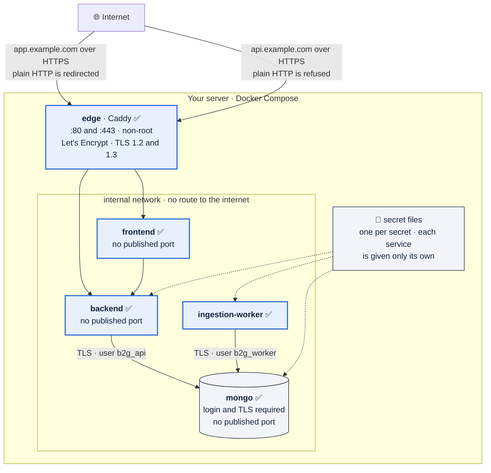

# Deployment

How to run B2G Vendor on a real server: HTTPS on two host names, MongoDB that needs a login and TLS,
secrets kept out of `.env` files, and no container running as root.

This document answers *how do I deploy and run it*. *Why* each control exists is
[Security.md](Security.md); *where* the pieces live is [Architecture.md](Architecture.md). The local
stack (`docker compose up`) is unchanged and stays plain HTTP: this is a second set of files you add
on top for a server.

**Legend:** ✅ configured, and proven on a rehearsal stack on one machine · ⬜ cannot be shown without
a public server and domain (section 8).

---

## 1. What changes between the local stack and a deployment

| Concern | Local stack (`docker-compose.yml`) | Deployment (adds `docker-compose.prod.yml`) |
| :--- | :--- | :--- |
| Who is reachable | Website on `:3000`, API gateway on `:4000`, MongoDB on `:27017` | **Only the edge**, on `80` and `443`. Nothing else publishes a port (Alertmanager's page stays on `127.0.0.1`) |
| Transport | Plain HTTP | HTTPS only: TLS 1.2 and 1.3, Mozilla "intermediate" cipher suites, Let's Encrypt certificates ✅ |
| Host names | `localhost` | The website and the API on **different** names: `app.example.com`, `api.example.com` ✅ |
| Plain HTTP | Works | The website redirects to HTTPS; the API **refuses** it with a `403`, never a redirect ✅ |
| MongoDB | No login, no TLS, published port | A login, TLS required, **one user per service** with `readWrite` on the application database only, no published port ✅ |
| Secrets | In `.env` files | One **file** per secret from Docker secrets; each service gets only the files it needs ✅ |
| Containers | The images' defaults | Application containers run as an unprivileged user, with every capability dropped, no privilege escalation, and a read-only file system ✅ |
| Startup checks | None | `REQUIRE_SECURE_BACKENDS=true`: the API and the worker refuse to start with a MongoDB address that has no login or no TLS, and never send mail without TLS ✅ |



---

## 2. Before you start

- A Linux server with Docker and a **recent Docker Compose** (the files use the `!reset` and `!override`
  merge tags, which need Compose 2.24 or newer; tested with 2.40).
- **Two DNS names** that point at the server, siblings of one domain: `app.example.com` and
  `api.example.com`. The session cookie is `SameSite=Lax`, which needs both on the same registrable
  domain. Let's Encrypt checks the names, so they must resolve before the first start.
- **Ports 80 and 443** open to the internet. Port 80 is needed for certificate issuance and for the
  website's redirect.
- An **SMTP account that supports TLS** (port 587 with STARTTLS, or 465). Sign-up needs email. Add its
  host to `docker/proxy/allowed-domains.txt`: outgoing mail leaves only through that allow-list.
- `openssl`, `curl` and `perl` on the machine you run the scripts from.

---

## 3. Step by step

**1. Settings.** In the repository root:

```bash
cp .env.example .env
cp Backend/.env.production.example Backend/.env
cp B2GVendor/.env.example B2GVendor/.env
```

Edit `.env`: set `APP_HOST`, `API_HOST` and `ACME_EMAIL`, and add the line
`COMPOSE_FILE=docker-compose.yml:docker-compose.prod.yml`, so that a plain `docker compose` can never
start the local stack by mistake. Edit `Backend/.env`: set `SMTP_HOST`, `SMTP_PORT`, `SMTP_USER` and
`MAIL_FROM`. **Put no secret in either file**: the API and the worker refuse to start if
`MONGODB_URI`, `SMTP_PASS`, `OPENROUTER_API_KEY`, `DATA_GO_TH_API_KEY` or `MFA_ENCRYPTION_KEY` is set
there as well as in a secret file.

**2. Secrets.** The generator makes the MongoDB ones (random 40-character passwords for the root
user and the two service users, each service's connection address, and a private certificate
authority with a server certificate) and the key that encrypts the authenticator secrets of two-step
sign-in (`mfa_encryption_key`, 32 random bytes, base64):

```bash
docker/secrets/generate.sh
```

The four secrets that come from providers are stored without echo, or from a pipe. Use `--unused` for
a feature you do not use:

```bash
docker/secrets/generate.sh set smtp_pass
docker/secrets/generate.sh set openrouter_api_key --unused
docker/secrets/generate.sh set data_go_th_api_key --unused
docker/secrets/generate.sh set google_credentials --unused
docker/secrets/generate.sh check
```

`check` stops you if a password is short, repeated or a default value, an address and its password
disagree, a certificate does not verify or is about to expire, the two-step key is not exactly 32
bytes, or a file is writable by everyone. The `secrets/` folder is private to you (mode 0700) and git
ignores it.

**Back up `secrets/mfa_encryption_key` somewhere safe, apart from the database backups.** It is never
replaced once it exists, and without it every enrolled authenticator is unreadable (section 5).

**3. Start.**

```bash
docker compose up -d --build
docker compose logs -f edge
```

The first start builds the images, creates the MongoDB users (only when its data directory is empty),
and asks Let's Encrypt for two certificates. ClamAV downloads its signatures for a minute or two; until
then a TOR file scan fails closed and is retried at the next poll.

**4. The first Super Admin, and the sites.** The production image has no `tsx`, so run the compiled
scripts. Staff must use two-step sign-in, so the first sign-in of this account is taken straight to
**Account security** to scan a QR code with an authenticator app and save its ten recovery codes; until
that is done every staff page answers `403 MFA_SETUP_REQUIRED`. Type the password without echo, so it is not left in your shell history:

```bash
read -rs SEED_SUPERADMIN_PASSWORD; export SEED_SUPERADMIN_PASSWORD
SEED_SUPERADMIN_EMAIL=you@example.com docker compose exec -e SEED_SUPERADMIN_EMAIL -e SEED_SUPERADMIN_PASSWORD backend node dist/scripts/seedSuperAdmin.js
unset SEED_SUPERADMIN_PASSWORD
docker compose exec backend node dist/scripts/seedGovSites.js
docker compose exec backend node dist/scripts/seedTags.js
```

**5. Prove it.** See section 4.

---

## 4. Checking it

From any machine, against the running server. Without `--cacert` the certificate must be one the system
trusts, which is what shows it is publicly trusted:

```bash
docker/verify-deployment.sh probe --app app.example.com --api api.example.com
```

It checks, for both hosts: a verified TLS connection with the right host name; TLS 1.3 preferred; TLS
1.2 accepted; TLS 1.1 and 1.0 refused (and only counted if the same client could speak them to a server
that allows them); every TLS 1.2 cipher suite the client knows, where **only** the recommended
forward-secret ones are accepted; the three TLS 1.3 suites; plain HTTP redirected for the website and
refused for the API; HSTS on both; and that CORS allows the website's origin and no other.

Without a server, rehearse the whole thing on one machine:

```bash
docker/verify-deployment.sh local
```

It builds and starts MongoDB, the API, the worker, the website and the edge with throw-away secrets and
Caddy's own test CA, on host names under `.localhost`; runs the probe above; then checks what only the
inside can show: only the edge publishes a port; who runs as root; which secrets each service can read;
that none is in a service's environment (the two-step key included, and only the API is given it); that
MongoDB refuses a connection with no login or no TLS; that each MongoDB user sees only the application
database; that a real sign-in works across the two host names, with the right cookie attributes; and
that two-step sign-in works end to end (a Super Admin who has not enrolled is refused, enrolling with a
code made from the secret, a recovery code completes a sign-in once and only once, and the seed in the
database is encrypted). It removes everything afterwards (`--keep` to look around).

The settings themselves are also checked without any server, by `npm run check:deployment-config` in
`Backend/` (and so by `npm test`).

---

## 5. Day to day

**Update.**

```bash
git pull
docker compose up -d --build
```

Changing `API_HOST` rebuilds the website image (its API address is fixed when it is built).

**Certificates.** Let's Encrypt certificates are renewed by Caddy by itself, well before they expire; keep
the `edge-data` volume, because it holds them and the ACME account. MongoDB's own certificate lasts 365
days; renew it, and restart MongoDB so it is used (the API and worker reconnect on their own):

```bash
docker/secrets/generate.sh renew-mongo-cert
docker compose restart mongo
```

**Rotating a secret.** Replace the secret, restart what uses it, then revoke the old one where it came from.

| Secret | How |
| :--- | :--- |
| `smtp_pass`, `openrouter_api_key`, `data_go_th_api_key`, `google_credentials` | `docker/secrets/generate.sh set NAME`, then `docker compose up -d --force-recreate backend ingestion-worker` |
| `mfa_encryption_key` | **Do not replace it casually**: the seeds already in the database were written with the old key. See "Two-step sign-in" below |
| `mongo_api_password` or `mongo_worker_password` | Change it inside MongoDB **first**, then the files (below) |
| `mongo_root_password` | The same, for the user `b2g_root` in the `admin` database |

A MongoDB user's password, for `b2g_api` (use `b2g_worker` and `mongo_worker_*` for the worker). The
new password travels in the environment, not on a command line, and the root password is read
inside the container:

```bash
export NEW="$(openssl rand -base64 60 | tr -d '/+=\n' | cut -c1-40)"
docker compose exec -T -e NEW mongo mongosh --quiet --tls --tlsCAFile /etc/mongo-tls/ca.pem --host localhost --eval '
  const fs = require("fs");
  db.getSiblingDB("admin").auth("b2g_root", fs.readFileSync("/run/secrets/mongo_root_password", "utf8").trim());
  db.getSiblingDB("b2gvendor").changeUserPassword("b2g_api", process.env.NEW);'
printf '%s\n' "$NEW" > secrets/mongo_api_password
rm secrets/mongo_api_uri && docker/secrets/generate.sh     # rebuilds the address from the new password
docker compose up -d --force-recreate backend
unset NEW
```

**Two-step sign-in.** Admin and Super Admin accounts must set up an authenticator app before they can use
any staff page; vendors may turn it on for themselves (Account → Security). This is always on in
production (`MFA_REQUIRED_FOR_STAFF` is fixed to `true` in `docker-compose.prod.yml`). What an operator
needs to know:

- **The server's clock matters.** A code is checked against the server's time, with one 30-second step
  of drift either way, and a code that was used is refused. Keep the host synchronised (NTP: `timedatectl
  status` should say `System clock synchronized: yes`); a server whose clock is minutes out will refuse
  every correct code.
- **A person lost their authenticator and their recovery codes.** An Admin resets a vendor, and the Super
  Admin resets an Admin, from the Accounts and Admin users pages (**Reset two-step sign-in**), after
  checking who is asking by a means other than the sign-in itself. The form records how it was
  checked and why, asks for the administrator's own password, ends every session of that account and
  emails its owner; the person signs in with the password alone and sets up again. The audit log keeps
  who, whom, how it was checked and why.
- **The last Super Admin cannot be reset from the website** (there is nobody above them). On the server:

  ```bash
  docker compose exec backend node dist/scripts/resetMfa.js you@example.com "Identity confirmed by <who, how>"
  ```

  It needs access to the container, which is the check; it writes the same audit entry.
- **`mfa_encryption_key` lost or leaked.** Lost: no authenticator can be read, and nobody can sign in who
  had one enabled. Put a new key in `secrets/`, restart `backend`, and reset each account that had
  two-step sign-in (the script above takes an email address). Leaked: the seeds are only useful together
  with a copy of the database, but treat it as a breach of the database and have everyone re-enrol.
  Keep a copy of the key apart from the backups of the database.

**Backing up.** The data that matters is MongoDB. A dump (as the root user), to store off the server,
encrypted:

```bash
docker compose exec -T mongo sh -c 'mongodump --quiet --ssl --sslCAFile /etc/mongo-tls/ca.pem --host localhost \
  -u b2g_root -p "$(cat /run/secrets/mongo_root_password)" --authenticationDatabase admin --db b2gvendor --archive' > b2g.archive
```

Restore with `mongorestore` and the same options (`--drop --archive < b2g.archive`). The TOR files in
`tor-storage` are downloaded again from the government sites if they are lost, and `edge-data` holds the
certificates, which Let's Encrypt can reissue.

---

## 6. Moving an existing local stack

**MongoDB data.** The hardened MongoDB creates its users only when its data directory is **empty**. Do
not point it at a volume made by the local stack: it would start with authentication on and no users in
it. Start the deployment empty, then move the data with `mongodump` from the old stack (`docker compose
-f docker-compose.yml exec -T mongo mongodump --db b2gvendor --archive > b2g.archive`) and
`mongorestore --ssl ... --drop --archive < b2g.archive` into the new one, as in section 5.

**TOR files and non-root.** The images now run as an unprivileged user (`node`, uid 1000). A **new**
`tor-storage` volume inherits the right owner from the image. One created by an earlier image, which
ran as root, must be handed over once, or the worker cannot save files:

```bash
docker compose stop ingestion-worker backend
docker run --rm -v b2gvendor_tor-storage:/data alpine chown -R 1000:1000 /data
docker compose up -d
```

(Compose names the volume `<project>_tor-storage`, and the project is the folder's name in lower case.
Check with `docker volume ls`.)

---

## 7. Files

| File | What it is |
| :--- | :--- |
| `docker-compose.prod.yml` | The production overlay: the edge, MongoDB's login and TLS, secrets, hardening |
| `docker/edge/Caddyfile`, `docker/edge/Dockerfile` | The TLS proxy and its non-root image |
| `docker/mongo/entrypoint.sh`, `docker/mongo/init-users.sh` | MongoDB's private copies of its secrets, and the creation of the two service users |
| `docker/secrets/generate.sh` | Creates, stores, checks and renews the secrets (the two-step sign-in key included) |
| `Backend/src/scripts/resetMfa.ts` | Resets a Super Admin's two-step sign-in from the server (`node dist/scripts/resetMfa.js`) |
| `docker/verify-deployment.sh` | `probe` a running deployment · `local` rehearsal |
| `Backend/.env.production.example` | The API and worker settings, with no secret in them |
| `Backend/src/config/secretFiles.ts` | Reads `NAME_FILE` secrets |
| `Backend/src/config/transportSecurity.ts` | The MongoDB and mail TLS rules behind `REQUIRE_SECURE_BACKENDS` |
| `Backend/tests/integration/deployment-config.check.ts` | The settings above, checked without a server |

---

## 8. What was proven, and what was not

Each ASVS 5.0 requirement, where it is configured, and how it was shown.

| ASVS | Requirement in short | Configured in | Shown by |
| :--- | :--- | :--- | :--- |
| V3.5.4 | Website and API on different host names | Caddyfile, compose (`APP_HOST`, `API_HOST`) | Rehearsal: sign-in and the cookie work across the two names |
| V4.1.2 | HTTP redirects to HTTPS for the website only | Caddyfile | Rehearsal: website `308`, API `403` and no redirect |
| V12.1.1 | TLS 1.2 and 1.3 only | Caddyfile | Rehearsal: 1.3 preferred, 1.2 accepted, 1.1 and 1.0 refused |
| V12.1.2 | Recommended cipher suites only | Caddyfile | Rehearsal: every TLS 1.2 suite the client knows (89 on the machine used) was tried, and only 3 recommended ones were accepted |
| V12.2.1 | HTTPS only | compose (only the edge publishes ports) | Rehearsal and `check:deployment-config` |
| V12.2.2 | Publicly trusted certificates | Caddyfile (`TLS_ISSUER` = ACME email: Let's Encrypt) | ⬜ Needs a public domain: run `probe` against the real server |
| V12.3.1 | TLS on every connection | MongoDB `requireTLS`; mail `REQUIRE_SECURE_BACKENDS` | Rehearsal (MongoDB without TLS is refused); `check:transport-security` (mail, against real servers) |
| V13.2.1 | A user per service, authenticated | `docker/mongo/init-users.sh`, compose | Rehearsal: a connection with no login is refused |
| V13.2.2 | Least privilege, non-root | Dockerfiles, compose | Rehearsal: each user sees only the application database; every container's user and capabilities |
| V13.2.3 | No default credentials | `docker/secrets/generate.sh` | `check:deployment-config` (random, distinct; `check` rejects defaults) |
| V13.3.1 | A secret store, not `.env` | compose secrets, `secretFiles.ts` | `check:secret-files`; rehearsal: no secret in any environment |
| V13.3.2 | Least privilege on secrets | compose (`secrets:` per service) | Rehearsal and `check:deployment-config`: each service lists only its own |
| V14.2.4 | Controls for sensitive data in transit and at rest | all of the above | as above |

**Not proven here:**

- **Real certificate issuance (V12.2.2).** The rehearsal uses Caddy's own CA so it can run without a
  public domain. That Let's Encrypt issues the certificates is shown only on the real server, by
  `probe` (which trusts only what the system trusts).
- **The DHE cipher suites** in Mozilla's "intermediate" list are not offered: Go's TLS does not
  implement them, and they are the weakest entries. Everything offered is ECDHE.
- **Third-party images** (Squid, ClamAV, Loki, Alloy, Alertmanager) keep their own default users; this
  overlay does not change them. Alloy needs the Docker socket (read-only) to read logs. MongoDB's
  entrypoint starts as root only to hand its data directory and secrets to the `mongodb` user, then
  runs `mongod` as that user.
- **One host.** Everything is one Docker host; the TOR files are on a local volume. Moving to several
  hosts means an object-storage adapter for the files, a replica set for MongoDB, and a shared secret
  store (the services already read `/run/secrets/<name>`, which Swarm, Kubernetes and the cloud secret
  managers all provide).
